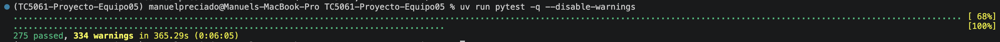
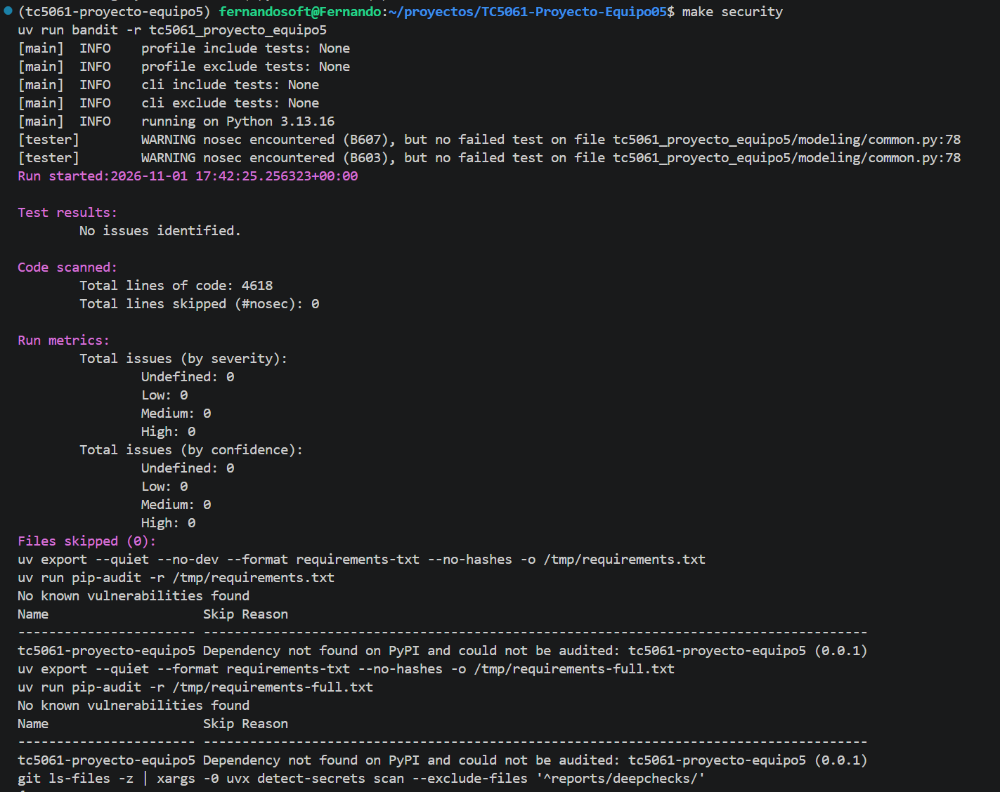
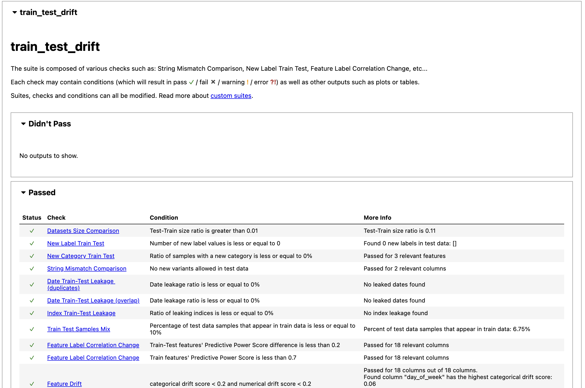
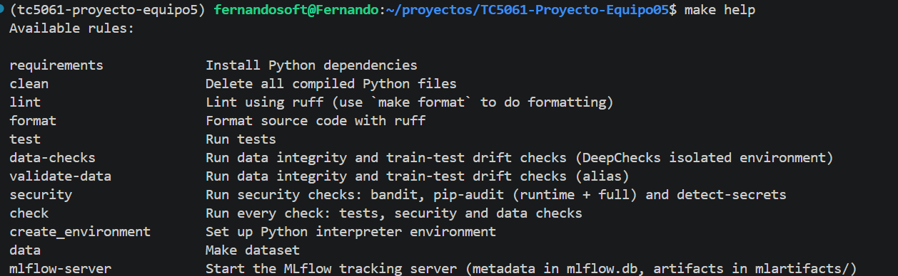
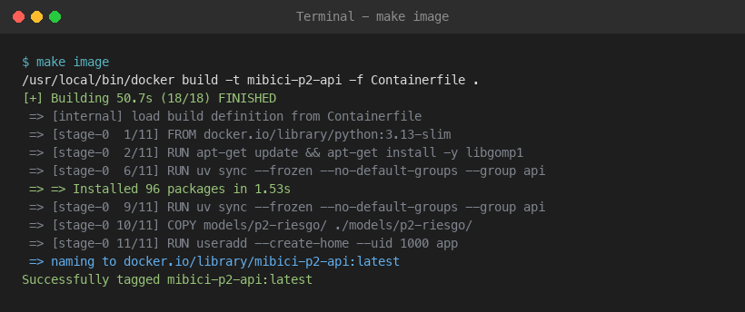
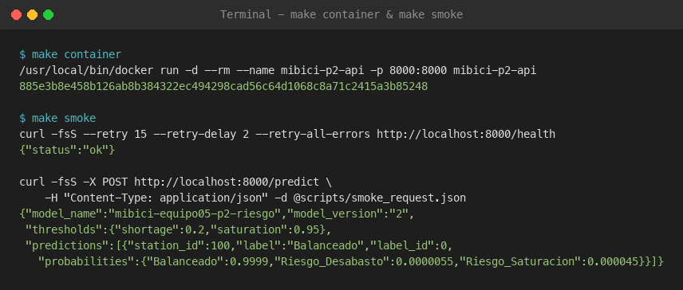
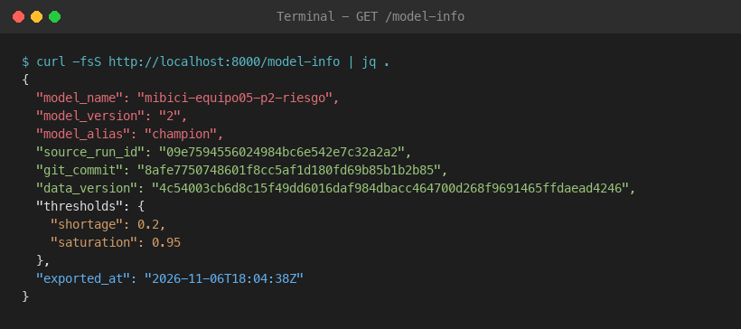
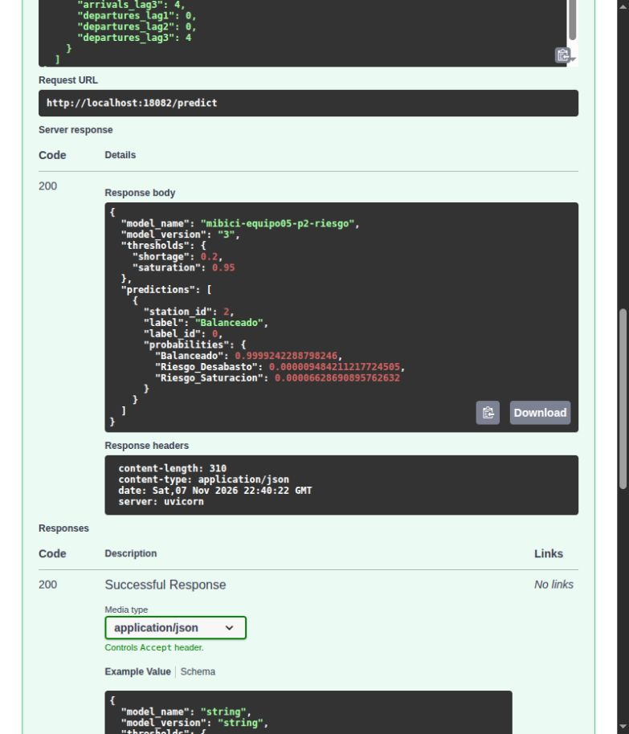
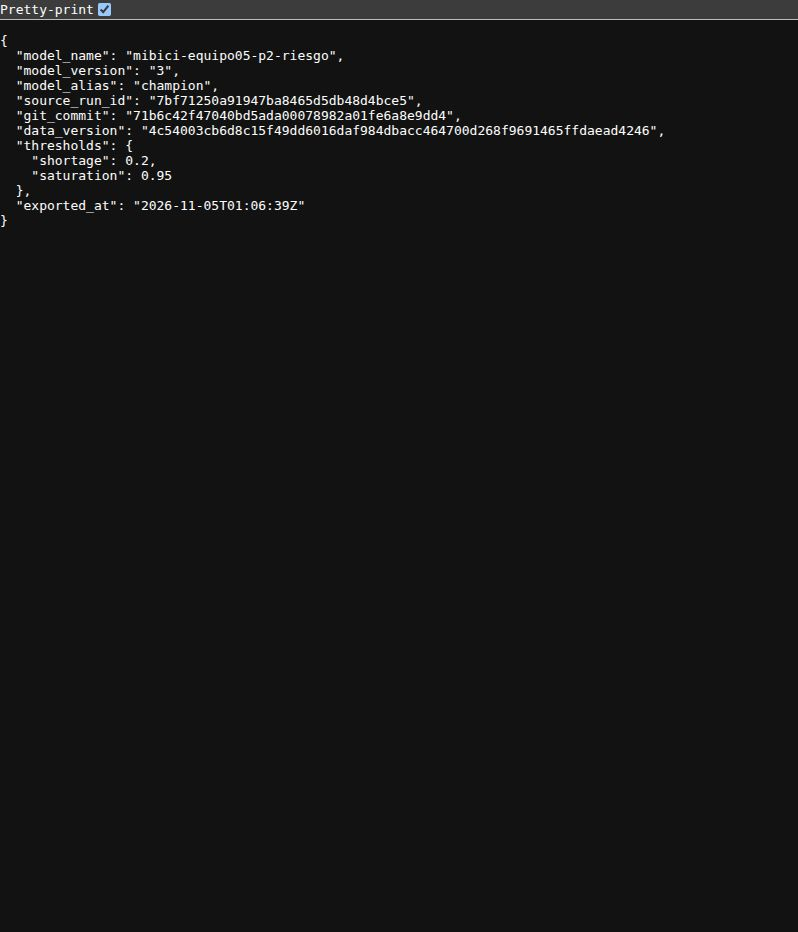

# MiBici · MLOps (TC5061 · Equipo 05)

<a target="_blank" href="https://cookiecutter-data-science.drivendata.org/">
    
</a>

## Propósito

MiBici, el sistema de bicicleta pública del Área Metropolitana de Guadalajara, necesita
anticipar dónde y cuándo se usarán sus bicicletas para planear la flota y el rebalanceo de
estaciones. Este proyecto propone una solución de Machine Learning reproducible que combina
regresión, clasificación y clustering sobre los datos abiertos de viajes, con ingesta
versionada, feature engineering sin fuga de información y experimentos trazables en MLflow.

## Preguntas de negocio

| | Pregunta | Tarea | Métrica primaria | Canvas |
|:---|:---|:---|:---|:---|
| **P1** | ¿Cuántos viajes se iniciarán en una estación durante la siguiente hora? | Regresión por estación-hora | WAPE (también MAE y RMSE) | [p1-demanda](docs/docs/canvases/p1-demanda.md) |
| **P2** | ¿Una estación se quedará sin bicicletas o sin anclajes durante la siguiente hora? | Clasificación de tres clases (desabasto, balanceada, saturación) | Macro-F1 y PR-AUC | [p2-riesgo](docs/docs/canvases/p2-riesgo.md) |
| **P3** | ¿Qué grupos de estaciones comparten patrones de uso y dónde se ubican? | Clustering de perfiles horarios | Silhouette y Davies-Bouldin | [p3-clustering](docs/docs/canvases/p3-clustering.md) |

P1 y P2 predicen con una hora de anticipación: a las `h-00:10` se predice la hora `[h, h+1)`,
usando solo información disponible en ese momento.

## Datos

- **Fuente:** [datos abiertos de MiBici](https://www.mibici.net/es/datos-abiertos/), con un
  CSV de viajes por mes (id de viaje, inicio, fin, estación de origen y de destino) y el
  catálogo de estaciones (id, nombre, coordenadas y capacidad). El portal solo publica la
  versión más reciente del catálogo.
- **Periodo descargado:** de enero de 2024 a septiembre de 2026 (33 archivos, 12.5 M viajes),
  definido por `INITIAL_YEAR` y `END_YEAR` en `tc5061_proyecto_equipo5/config.py`.
- **Año de estudio:** 2024 (4.6 M viajes, unas 370 estaciones activas), con partición temporal:
  train de enero a septiembre, validación de octubre a noviembre y test de diciembre.
  2025 y 2026 se reservan para monitoreo. La elección está justificada en
  [justificación del periodo de estudio](docs/docs/justificacion-periodo-estudio.md).
- **Versionado:** los datos no se guardan en Git. `references/viajes_manifest.json` registra el
  hash de cada archivo y un `data_version` global, que cada run de MLflow guarda como parámetro.
- **Privacidad:** los Parquet conservan las columnas personales del portal (usuario, género,
  año de nacimiento), pero ninguna receta de features ni modelo las usa.

## Instalación

Requisitos: Python 3.13, [uv](https://docs.astral.sh/uv/) y Git. LightGBM necesita además
OpenMP: en macOS `brew install libomp`; en Linux o WSL `sudo apt install libgomp1`. Si
`uv sync` falla al leer `uv.lock` por una versión vieja de uv, actualízalo con
`uv self update`.

```bash
git clone https://github.com/alx016/TC5061-Proyecto-Equipo05.git
cd TC5061-Proyecto-Equipo05
uv sync                 # crea .venv con las versiones fijadas en uv.lock
uv run pytest           # verifica la instalación
```

Los comandos de este README usan `uv run`; si se activa el entorno (`source .venv/bin/activate`)
basta con `python`. En un clon nuevo, usar una terminal sin otro entorno activado (o `deactivate`)
para que `uv` instale en el `.venv` del clon.

## Ingesta

```bash
make data
```

Descarga los CSV mensuales a `data/raw/`, los limpia y convierte a Parquet en
`data/interim/viajes/year=YYYY/`, descarga el catálogo de estaciones a
`data/external/estaciones/` y escribe `references/viajes_manifest.json`.

Para verificar que los datos locales coinciden con el manifest del repositorio:

```bash
uv run python tc5061_proyecto_equipo5/dataset.py manifest --check
```

## MLflow Project (Entrega 2)

Una sola vez, copiar las variables de MLflow:

```bash
cp .env.example .env
```

En una terminal aparte, levantar el servidor de tracking y dejarlo abierto:

```bash
make mlflow-server      # http://127.0.0.1:5001
```

En cada terminal nueva, cargar las variables y correr los entry points:

```bash
set -a; source .env; set +a
uv run mlflow run . -e ingest --env-manager local
uv run mlflow run . -e features -P question=p1 --env-manager local
uv run mlflow run . -e train -P question=p1 -P model=seasonal_mean -P stage=baseline --env-manager local
uv run mlflow run . -e search -P question=p1 --env-manager local
```

- `Connection refused` en el puerto 5001: el servidor no está corriendo.
- `active experiment ID does not match`: faltó cargar `.env` (`MLFLOW_EXPERIMENT_NAME`).
- `--env-manager local` usa el `.venv` del proyecto; sin esa opción MLflow construye el
  entorno de `python_env.yaml` con pyenv y virtualenv.

## Experimento base (Entrega 1)

Cada pregunta tiene su propio script de entrenamiento y todos registran sus runs en el
experimento `mibici-equipo05` de MLflow. Las corridas de evidencia usan el servidor local
(`make mlflow-server`, SQLite en `mlflow.db` y artefactos en `mlartifacts/`) y
`MLFLOW_TRACKING_URI=http://127.0.0.1:5001`. El pipeline completo, después de la ingesta:

```bash
# 0. Servidor de tracking (terminal aparte)
make mlflow-server
export MLFLOW_TRACKING_URI=http://127.0.0.1:5001
export MLFLOW_EXPERIMENT_NAME=mibici-equipo05

# 1. Features (los artefactos se escriben en data/processed/)
uv run python -m tc5061_proyecto_equipo5.features main --problem p1 --prepare-ready \
  --input-dir data/interim/viajes --output-dir data/processed/fe_2024_v4
uv run python -m tc5061_proyecto_equipo5.features classification
uv run python -m tc5061_proyecto_equipo5.features main --problem p3 --prepare-ready \
  --input-dir data/interim/viajes --output-dir data/processed/fe_2024_v4

# 2. Entrenamiento
uv run python -m tc5061_proyecto_equipo5.modeling.train_regression regression

# P2: un modelo por run; train no evalúa test
uv run mlflow run . -e train -P question=p2 -P model=lightgbm \
  -P stage=baseline --env-manager local
uv run mlflow run . -e train -P question=p2 -P model=lightgbm_unweighted \
  -P stage=candidate --env-manager local
uv run mlflow run . -e search -P question=p2 -P model=lightgbm --env-manager local
uv run mlflow run . -e select -P question=p2 --env-manager local

uv run python -m tc5061_proyecto_equipo5.modeling.train_clustering clustering

# 3. Resultados
uv run mlflow ui --backend-store-uri sqlite:///mlflow.db --port 5001
```

`features main --prepare-ready` no sobrescribe una carpeta existente; para regenerar los
artefactos hay que mover o borrar antes `data/processed/fe_2024_v4/p1` o `p3`. En macOS el
puerto 5000 lo ocupa AirPlay, por eso se usa el 5001.

| Pregunta | Script | Candidatos | Selección |
|:---|:---|:---|:---|
| P1 | `modeling/train_regression.py` | Promedio estacional, Ridge, LightGBM Poisson, LightGBM Tweedie, HistGradientBoosting Poisson | `regression` elige por WAPE de validación y evalúa solo su finalista en test |
| P2 | `modeling/train_classification.py` | Persistencia, clase mayoritaria, regresión logística, LightGBM balanceado y sin balancear, HistGradientBoosting y Random Forest | Mayor macro-F1 de validación con guardrails de recall de desabasto (`>= 0.85`) y precisión mínima; si ninguno los cumple, se elige el mayor macro-F1 y se marca `selection_fallback=true`. Solo el run `selected=true` se evalúa en test |
| P3 | `modeling/train_clustering.py` | K-Means con K=4 de referencia, K-Means con el mejor K, Ward | K con la mayor silhouette de validación |

P2 no usa `predict` directamente: entrena con `predict_proba`, calibra un umbral para
desabasto y otro para saturación usando **solo validación**, y aplica esos umbrales antes de
calcular las métricas. `train` y `search` nunca tocan diciembre; `select` carga el modelo
elegido, evalúa test una sola vez y guarda las matrices de confusión, las curvas PR y el
`classification_report.txt` en `plots/test/`. `select` se ejecuta como entry point para que la
corrida quede registrada como proyecto MLflow; rechaza runs con `git_dirty=true`, así que las
pruebas locales sobre un árbol sucio deben usar el módulo directo con `--allow-dirty`.

### Etapas de experimentación P1

El catálogo de `regression` conserva promedio estacional, Ridge y LightGBM Poisson como
referencias de la Entrega 1, con `stage_of_work=baseline`. La referencia LightGBM se llama
`regression-baseline-lightgbm`.

El entrypoint `train` ejecuta una configuración por corrida y usa `stage=candidate` por
defecto. Para repetir la referencia LightGBM sin ajustar hiperparámetros:

```bash
uv run mlflow run . -e train -P question=p1 -P model=lightgbm -P stage=baseline \
  --env-manager local
```

Esa corrida se llama `p1-baseline-lightgbm`. Para una variante ajustada, usar
`-P stage=candidate` junto con los parámetros `hp_*`; no etiquetarla como baseline.

En `search`, todas las Trials conservan `stage_of_work=search`. Solo la ganadora recibe
`selected=true`, en correspondencia con `best_run_id` de la Study y la fila seleccionada
del CSV. Para localizarla, filtrar por `question=p1`, `stage_of_work=search` y la Study
(`mlflow.parentRunId`), además de `selected=true`. Este tag indica el mínimo WAPE del grid:
no equivale a seleccionar el finalista entre familias, evaluar diciembre o promover un champion.

Reglas comunes a los tres scripts:

- Las utilidades de reproducibilidad viven en `modeling/common.py`: `data_version()`,
  `setup_experiment()` y `base_tags(question)`. No se duplican.
- Cada run lleva los tags `team`, `question`, `git_commit` y `git_dirty`, y el parámetro
  `data_version`. Un run con `git_dirty=true` se entrenó con cambios sin commit y no es
  reproducible.
- Los nombres de las métricas llevan el split como prefijo: `val_wape`, `test_macro_f1`, etc.
- El código, los comentarios y los nombres de archivo van en inglés; las figuras y los
  artefactos de texto, en español.

Los contratos de features y el protocolo contra la fuga de información están en
[feature engineering](docs/docs/feature-engineering.md). P2 usa el catálogo de estaciones más
reciente y supone que la capacidad no cambió desde 2024; ese supuesto debe reportarse junto con
los resultados.

## Model Registry

Cada pregunta tiene un modelo registrado: `mibici-equipo05-p1-demanda`,
`mibici-equipo05-p2-riesgo` y `mibici-equipo05-p3-grupos`. El entry point `register` toma
el run que ganó el `search` o `select` de su pregunta (tag `selected=true`) y lo registra
en el modelo que corresponde a su tag `question`:

```bash
uv run mlflow run . -e register -P run_id=<run ganador> --env-manager local                     # entra como challenger
uv run mlflow run . -e register -P run_id=<run ganador> -P alias=champion --env-manager local    # lo promueve
```

- **Aliases en lugar de stages.** Los stages están deprecados desde MLflow 2.9. `champion`
  equivale a Production y `challenger` a un candidato en comparación. El código que consume el
  modelo siempre carga `models:/<nombre>@champion`; promover o regresar a otra versión es
  mover el alias, sin cambiar ese código.
- Un registro nuevo entra como `challenger`, para no reemplazar al `champion` por accidente.
  Promover reusa la misma versión y le quita `challenger`.
- Cada versión guarda el linaje de su run: `source_run_id`, `git_commit`, `git_dirty`,
  `data_version`, `features_data_version`, `selected` y los tags `selection_*` de su `select`.
- De P1 se registra el Trial con `selected=true`, no la Study: la Study no guarda modelo.

Para usar el modelo desde cualquier carpeta:

```python
import mlflow

mlflow.set_tracking_uri("http://127.0.0.1:5001")
model = mlflow.pyfunc.load_model("models:/mibici-equipo05-p1-demanda@champion")
```

El modelo carga fuera del repositorio porque se guarda con el código del paquete
(`code_paths`). En MLflow 3, `runs:/<id>/model` apunta al logged model del run; el aviso
"has no artifacts at artifact path 'model'" al registrar es normal.

## Pruebas y chequeos (Entrega 3)

Todo se corre desde la raíz del repositorio:

```bash
make test          # pruebas unitarias (pytest)
make data-checks   # validación de datos con DeepChecks
make security      # bandit, pip-audit y detect-secrets
make check         # las tres anteriores
```

`make test` no necesita datos. `make data-checks` y `make check` sí: leen
`data/processed/classification_features.parquet`, que se genera con `make data` y el entry
point `features` de `MLproject`. Si el archivo no existe, el target se detiene con un mensaje
antes de ejecutar DeepChecks.

### Pruebas (pytest)

`make test` corre `uv run pytest tests`. Las pruebas usan datos sintéticos y un tracking temporal de MLflow, por lo que no necesitan los datos del proyecto ni el servidor local. La primera corrida necesita conexión para crear el entorno aislado de DeepChecks. También se comprueba que el entrenamiento con la misma semilla produzca los mismos resultados en los modelos de regresión, clasificación y clustering. Las pruebas incluyen casos normales y entradas inválidas.

### Validación de datos (DeepChecks)

`make data-checks` ejecuta las suites de integridad y de comparación entre entrenamiento y prueba sobre las features de P2. Antes de ejecutar los chequeos valida las columnas, los tipos, las particiones y las etiquetas.

En la corrida con los datos de 2024 encontramos 0.30% de etiquetas conflictivas y 6.75% de muestras con las mismas características y etiqueta en entrenamiento y prueba. Ambos superan los umbrales originales de 0% y 5%, por lo que aparecen como advertencias (WARN) en los reportes y en la consola, pero quedan dentro de los límites operativos de 0.5% y 10%, que son los que detienen la ejecución (FAIL). El comando termina con error si se supera alguno de los límites, falla otra condición o no se puede ejecutar un chequeo. Los detalles están en `reports/deepchecks/hallazgos.md` y `reports/deepchecks/check_policy.md`. Para generar los reportes sin detener la ejecución por una condición fallida se puede usar `uv run scripts/data_checks.py --report-only`.

Los reportes HTML y JSON se escriben en `reports/deepchecks/` y no se versionan: se regeneran
con el comando. La evidencia queda en `hallazgos.md`, en `check_policy.md` y en la captura de
abajo.

El script corre en un entorno aislado (PEP 723, Python 3.12), porque deepchecks no es
compatible con la versión de scikit-learn del proyecto. Por eso la validación vive en
`scripts/data_checks.py` y no dentro de `tc5061_proyecto_equipo5/`: necesita Python 3.12 y
versiones anteriores de numpy, pandas y scikit-learn, que no se pueden instalar junto con las
del proyecto, y dentro del paquete quedaría un módulo que no se puede importar. Los avisos de
`pkg_resources` al ejecutarlo son esperados.

### Seguridad

`make security` corre tres herramientas:

- **bandit**: análisis estático del paquete `tc5061_proyecto_equipo5`.
- **pip-audit**: vulnerabilidades conocidas en las dependencias, primero las de ejecución y
  después todas (incluidas las de desarrollo).
- **detect-secrets**: secretos en los archivos versionados. El escaneo completo se guarda en
  `reports/security/detect-secrets.json` (fuera de Git) y `detect-secrets-hook` falla si
  aparece un secreto que no esté en `.secrets.baseline`. El baseline contiene las 53
  coincidencias ya revisadas; todas son falsos positivos: imágenes en base64 dentro de los
  notebooks y los hashes SHA-256 de `references/viajes_manifest.json`.

Los resultados y su análisis están en `reports/security/resultados.md`. El 1 de noviembre
pip-audit detectó cuatro CVE nuevas en `pyasn1` 0.6.4 (dependencia indirecta de MLflow); se
corrigieron actualizando a 0.6.5.

`make security` no escanea el historial de Git: gitleaks no es un paquete de PyPI. El comando
para hacerlo queda documentado en `resultados.md`.

### Evidencia

En la última revisión, `make test` terminó con 275 pruebas aprobadas, y `make security` y `make data-checks` también terminaron correctamente. Capturas de la sesión de validación, con el comando que produjo cada una:

- `uv run pytest -q --disable-warnings` → 275 passed
  
- `make security` → bandit sin hallazgos y pip-audit sin vulnerabilidades
  
- reporte HTML de `make data-checks` → `Train Test Samples Mix` con advertencia (6.75%: WARN arriba de 5%, FAIL arriba de 10%)
  
- `make help` → targets disponibles
  

## Servicio de inferencia y contenedor OCI (Entrega 4)

La Entrega 4 expone el modelo champion de riesgo operativo de estaciones (P2) a través de una API REST construida con FastAPI. El servicio se empaqueta en una imagen de contenedor OCI compatible con Podman y Docker.

### Justificación de la estrategia de despliegue

MiBici opera una red de transporte con fluctuaciones de demanda en tiempo real. Los operadores de campo y las camionetas de rebalanceo necesitan conocer el riesgo de desabasto y saturación con anticipación inmediata.

Se eligió inferencia en tiempo real con peticiones síncronas por las siguientes razones:

1. **Decisiones operativas inmediatas.** El balanceo físico de bicicletas se decide minuto a minuto. Un proceso por lotes diferido cada varias horas no permite reaccionar a tiempo a la saturación de una estación.
2. **Soporte de micro-lotes.** El endpoint `/predict` acepta entre 1 y 500 registros por llamada. Un cliente puede calificar un corredor completo o toda la red metropolitana en una sola petición HTTP sin incurrir en la latencia de arranque de un proceso batch.
3. **Validación estricta en el borde.** Pydantic v2 valida las variables geográficas y temporales en la entrada. Si un sensor envía un dato fuera de rango, el servicio rechaza la petición con código 422 antes de transferir los datos al modelo.

### Decisiones de diseño

- **Decisión 4.2 (Empaquetado autónomo en la imagen).** La imagen incluye los artefactos del modelo (`MLmodel`, `model.pkl`) y sus metadatos de linaje (`registry_metadata.json`) en `models/p2-riesgo/`. Una vez construida, la imagen puede ejecutar inferencia sin red ni servidor MLflow; la construcción inicial requiere acceso a las imágenes base y dependencias.
- **Decisión 4.3 (Carga en vivo desde el Registry, alternativa).** Si `MODEL_URI` empieza con `models:/`, la API carga el modelo del Registry al arrancar en lugar de usar la copia de la imagen. Para eso, el servidor de MLflow se levanta con `make mlflow-server MLFLOW_HOST=0.0.0.0` (sin contraseña, solo durante la demo) y el contenedor recibe `MLFLOW_TRACKING_URI=http://host.containers.internal:5001` (Podman) o `http://host.docker.internal:5001` (Docker). Si el servidor no responde, el modelo no carga y la API responde 503.
- **Seguridad rootless.** El archivo `Containerfile` utiliza `python:3.13-slim`, instala `libgomp1` para OpenMP y ejecuta la aplicación bajo el usuario de sistema `app` (`UID 1000`) sin privilegios de administrador.
- **Gobernanza de dependencias.** El contenedor instala las dependencias base del proyecto y el grupo de servicio con `uv sync --frozen --no-default-groups --group api`. Esto excluye los grupos de notebooks, documentación, pruebas y linters; las dependencias base aún incluyen librerías como LightGBM y scikit-learn.

### Prerrequisitos

Para ejecutar el contenedor se requiere un motor OCI:

- **Podman**: En macOS o Windows, inicializa la máquina virtual antes del primer uso:
  ```bash
  podman machine init --now
  ```
- **Docker**: Inicia la aplicación Docker Desktop.

El archivo `Makefile` detecta automáticamente si el comando disponible es `podman` o `docker`.

### Ejecución paso a paso

1. **Preparar el champion entregado:** desde un clon del repositorio, ejecuta:
   ```bash
   make prepare-model
   ```
   El archivo versionado `models/p2-champion-v3.zip` contiene el export del Registry `mibici-equipo05-p2-riesgo`, versión 3 (alias `champion` al exportarlo), run `7bf71250a91947ba8465d5db48d4bce5`. El comando verifica SHA-256 `73cab932d0eae7dbf2c4f78fe927610353a9184e86588d0eddf4cfcef23b305b` y crea `models/p2-riesgo/` con `MLmodel`, `model.pkl` y `registry_metadata.json`. Requiere Python 3 y no reemplaza una carpeta existente; para reemplazarla intencionalmente usa `python3 scripts/prepare_model.py --replace`.

   **Alternativa con Registry:** `make export-model` exporta la versión actual del alias desde un Registry ya poblado. Instala primero el entorno con `uv sync` y configura `MLFLOW_TRACKING_URI` para ese servidor; el `mlflow.db` y los artefactos locales no forman parte del repositorio. Esta opción puede producir una versión diferente de la respuesta de ejemplo.

2. **Construir la imagen de contenedor:**
   ```bash
   make image
   ```
   Comando equivalente manual:
   ```bash
   # Con Docker
   docker build -t mibici-p2-api -f Containerfile .

   # Con Podman
   podman build --format docker -t mibici-p2-api -f Containerfile .
   ```

3. **Ejecutar el contenedor en segundo plano:**
   ```bash
   make container
   ```
   El servicio queda disponible en `http://localhost:8000`.

4. **Ejecutar la prueba de humo:**
   ```bash
   make smoke
   ```
   El target valida la respuesta de `/health` y envía una predicción a `/predict` con `scripts/smoke_request.json`.

5. **Detener el contenedor:**
   ```bash
   docker stop mibici-p2-api
   # O con Podman:
   podman stop mibici-p2-api
   ```

Las variables `net_flow_lag*` y `neighbor_net_flow` expresan flujo neto normalizado por capacidad; las variables `arrivals_lag*` y `departures_lag*` son conteos horarios previos. `day_of_week` va de 0 (lunes) a 6 (domingo), y las coordenadas están en grados decimales.

La documentación interactiva de OpenAPI está disponible en el navegador en `http://localhost:8000/docs`, con ejemplos de estaciones reales de Guadalajara precargados.

### Ejemplos de uso con curl

Respuestas observadas con el bundle v3 incluido; las probabilidades pueden variar ligeramente según el entorno.

**Verificar estado del servicio:**
```bash
curl -fsS http://localhost:8000/health
```
Respuesta:
```json
{"status":"ok"}
```

**Consultar metadatos y linaje del modelo activo:**
```bash
curl -fsS http://localhost:8000/model-info
```
Respuesta:
```json
{
  "model_name": "mibici-equipo05-p2-riesgo",
  "model_version": "3",
  "model_alias": "champion",
  "source_run_id": "7bf71250a91947ba8465d5db48d4bce5",
  "git_commit": "71b6c42f47040bd5ada00078982a01fe6a8e9dd4",
  "data_version": "4c54003cb6d8c15f49dd6016daf984dbacc464700d268f9691465ffdaead4246",
  "thresholds": {
    "shortage": 0.2,
    "saturation": 0.95
  },
  "exported_at": "2026-11-05T01:06:39Z"
}
```

**Realizar una predicción de riesgo:**
```bash
curl -fsS -X POST http://localhost:8000/predict \
  -H "Content-Type: application/json" \
  -d @scripts/smoke_request.json
```
Respuesta:
```json
{
  "model_name": "mibici-equipo05-p2-riesgo",
  "model_version": "3",
  "thresholds": {
    "shortage": 0.2,
    "saturation": 0.95
  },
  "predictions": [
    {
      "station_id": 100,
      "label": "Balanceado",
      "label_id": 0,
      "probabilities": {
        "Balanceado": 0.9999242288798246,
        "Riesgo_Desabasto": 0.000009484211217724505,
        "Riesgo_Saturacion": 0.00006628690895762632
      }
    }
  ]
}
```

### Reproducibilidad técnica cruzada (WP-5)

Para validar la reproducibilidad técnica independiente del modelo champion de P2, se ejecutó el ciclo completo de re-entrenamiento determinista, registro, exportación y despliegue en una segunda máquina (macOS Apple Silicon con Docker), partiendo del commit auditable `8afe775` de `main` con árbol limpio (`git_dirty=false`).

#### Comparación de métricas frente al champion original

| Métrica / Parámetro | Champion original (Oscar, v3) | Reproducción cruzada (Emilio, v2) | Baseline referencia (v1) |
|:---|:---|:---|:---|
| **Run ID** | `7bf71250` | `09e75945` | `d168b74c` |
| **Commit de Git** | `71b6c42` | `8afe7750` | `8afe7750` |
| **Entorno de ejecución** | Linux x86_64 | macOS Apple Silicon (ARM64) | macOS Apple Silicon (ARM64) |
| **Motor de contenedores** | Podman (según registro del equipo) | Docker Desktop | Docker Desktop |
| **Hiperparámetro `num_leaves`** | 255 | 255 | 31 (default) |
| **Semilla determinista** | 42 | 42 | 42 |
| **Umbral de desabasto (`shortage`)** | 0.20 | 0.20 | 0.40 |
| **Umbral de saturación (`saturation`)** | 0.95 | 0.95 | 0.95 |
| **`val_pr_auc_minority_mean`** | 0.2884 | 0.2855 | 0.2576 |
| **`val_macro_f1`** | 0.4801 | 0.4774 | 0.4653 |
| **`val_recall_shortage`** | 0.8605 | 0.8602 | 0.8553 |
| **`val_precision_shortage`** | 0.0662 | 0.0652 | 0.0615 |
| **`test_macro_f1` (Diciembre)** | 0.4578 | 0.4551 | 0.4468 |
| **`test_pr_auc_minority_mean`** | 0.2462 | 0.2408 | 0.2232 |
| **`test_recall_shortage`** | 0.8452 | 0.8497 | 0.8444 |
| **`test_precision_shortage`** | 0.0476 | 0.0468 | 0.0462 |
| **`test_alerts_per_day`** | 765.6 | 780.1 | 776.6 |
| **Predicción `smoke_request.json`** | `Balanceado (id: 0)` | `Balanceado (id: 0)` | `Balanceado (id: 0)` |

#### Conclusiones de reproducibilidad

1. **Paridad de umbrales.** La búsqueda conjunta de umbrales sobre el conjunto de validación arrojó exactamente los mismos puntos de corte (`shortage = 0.20`, `saturation = 0.95`) en ambas máquinas independientes.
2. **Criterio de reproducibilidad (tolerancia del 30%).** Las métricas en el conjunto de prueba (diciembre) y validación mostraron una desviación relativa cercana al 1% entre Linux x86_64 y macOS ARM64 (`val_pr_auc_minority_mean` de 0.2884 frente a 0.2855, variación de 1.01%; `test_macro_f1` de 0.4578 frente a 0.4551, variación de 0.59%). Cumple holgadamente el criterio de aceptación del 30%.
3. **Consistencia de inferencia.** La carga útil de prueba (`scripts/smoke_request.json`) produce la misma clasificación operativa (`Balanceado`, `label_id: 0`) con certidumbre superior al 99.99% en ambos modelos champion.
4. **Auditoría completa de Git.** El run reproducido fue ejecutado sobre el commit base `8afe775` presente en `main`, garantizando trazabilidad completa en GitHub sin referencias a commits locales o inexistentes.

### Evidencia visual

Capturas de la reproducción independiente en macOS con Docker: muestran la versión 2 de ese Registry local, no el bundle v3 incluido. La numeración de versiones es propia de cada Registry.

- `make image`: construcción de la imagen con Docker
  
- `make container` y `make smoke`: arranque del contenedor y verificación de endpoints
  
- `curl /model-info`: consulta de linaje de entrenamiento y umbrales de decisión
  

**Comprobación adicional en Linux con Docker Desktop (7 de noviembre):** se construyó la imagen desde un clon limpio de esta rama, se inició el contenedor y se ejecutó el ejemplo de `/docs`. Estas capturas muestran el bundle v3 incluido en el repositorio; complementan la reproducción anterior en macOS, que utilizó su propio Registry.

- `POST /predict`: respuesta HTTP 200 con la predicción y versión 3
  
- `GET /model-info`: versión y linaje del modelo servido
  

## Flujo de trabajo con Git

- `main` siempre debe funcionar y no recibe commits directos.
- Cada cambio vive en su propia rama, nombrada según su tipo: `feat/` (funcionalidad),
  `fix/` (corrección) o `docs/` (documentación). Por ejemplo, `feat/regression-training`.
- Los commits siguen [Conventional Commits](https://www.conventionalcommits.org/):
  `tipo(alcance): descripción`, por ejemplo `feat(modeling): add the P1 regression training`.
- Todo cambio entra a `main` mediante un pull request revisado por otro integrante. Antes de
  abrirlo: `make lint` y `uv run pytest`.
- Los datos (`data/`), las exportaciones de trabajo y los runs de MLflow (`mlflow.db`, `mlruns/`) no se suben a
  Git; el archivo `models/p2-champion-v3.zip` es la copia versionada para esta entrega. Los datos se reconstruyen con `make data` y se verifican con el manifest.
- Antes de un entrenamiento que sirva como evidencia, el commit debe estar hecho para que el
  run quede con `git_dirty=false`.

## Integrantes

Contribuciones de cada integrante según el historial de Git de `main`.

| Integrante | Matrícula | Usuario | Contribuciones |
|:---|:---|:---|:---|
| Manuel Alejandro Preciado Morán | A01639643 | `alx016` | Estructura inicial del proyecto (plantilla Cookiecutter Data Science). Ingesta: descarga, limpieza a Parquet y manifest de los viajes (`dataset.py`), descarga del catálogo de estaciones y rango de datos 2024-2026. P1: script de regresión con MLflow (`train_regression.py`), registro de las fechas de cada split y de los hiperparámetros con `get_params()`. Tags `git_commit` y `git_dirty` para todos los runs (`common.py`). Validación de capacidad y festivos en `features.py`. Entrega 4: API REST de inferencia de P2 con FastAPI (`api/main.py`, `api/model.py`), endpoints `/health`, `/model-info` y `/predict`, carga del modelo desde la carpeta exportada o desde `models:/` según `MODEL_URI`, y decisión de la estrategia de despliegue (tiempo real frente a lotes). |
| Oscar Ulises López Vázquez | A01840039 | `oscarlv` | P2: feature engineering de clasificación, figuras de justificación del proxy de riesgo (`plots.py`) y baselines de clasificación con MLflow, incluido el candidato LightGBM (`train_classification.py`). P3: baselines de clustering con MLflow (`train_clustering.py`). Separación en un script de entrenamiento por pregunta con utilidades compartidas (`common.py`). Incorporación de MLflow al proyecto, catálogo de estaciones en el manifest y sus pruebas, y regeneración de `uv.lock`. Entrega 4: script de exportación desacoplada del champion de P2 desde el Model Registry (`scripts/export_model.py`, `models/p2-riesgo/`, `registry_metadata.json`). |
| Emilio Alejandro Martínez López | A01796936 | `Emilio` | Feature engineering causal por modelo (`features.py`) con sus pruebas y su validación. Sitio de documentación MkDocs: los ML Canvas de P1, P2 y P3, el contrato de feature engineering, la investigación de fuentes y la justificación técnica del periodo de estudio 2024 y de la partición temporal. Notebook de exploración inicial (`0.01-eaml`) y versiones exactas de las dependencias en `pyproject.toml`. Entrega 4: esquemas de validación de dominio con Pydantic v2 (`api/schemas.py`), suite de pruebas HTTP de la API (`tests/test_schemas.py`, `tests/test_api.py`, `tests/test_api_model.py`), validación de reproducibilidad técnica cruzada en macOS con Docker (WP-5) y documentación de la Entrega 4 en el README. |
| Fernando Gutiérrez Escárrega | A01840067 | `Fernando cuenta TEC` | Configuración del entorno con uv, Python 3.13 y dependencias fijas. Análisis exploratorio (`1.0-fge-eda-mibici.ipynb`): nomenclatura de estaciones, histórico 2014-2026, análisis de 2024 para feature engineering, auditoría de limpieza de 2024 y calendario de festivos, con sus figuras en `reports/figures/`. Entrega 4: empaquetado OCI rootless (`Containerfile`, `.containerignore`), gobernanza de dependencias de servicio en `pyproject.toml` y automatización en Makefile (`make export-model`, `make image`, `make container`, `make smoke`). |

Los merges de los pull requests hechos desde la web de GitHub aparecen con el nombre de la cuenta
de GitHub (por ejemplo, `Oscar` o `Manuel Alejandro Preciado Morán`), no con el usuario de Git.

## Estructura del proyecto

```
├── Makefile                   <- Comandos: make data, make lint, make test, make security, make prepare-model, make export-model, make image, make container, make smoke
├── Containerfile              <- Imagen de la API (python:3.13-slim, usuario sin root)
├── .containerignore           <- Lista blanca de inclusiones para construcción de imágenes
├── README.md
├── pyproject.toml             <- Metadatos del paquete, dependencias y configuración de ruff
├── uv.lock                    <- Versiones exactas de las dependencias
├── data/                      <- Fuera de Git; se genera con make data
│   ├── raw/                   <- CSV mensuales descargados
│   ├── interim/viajes/        <- Viajes limpios en Parquet, particionados por año
│   ├── external/estaciones/   <- Catálogo de estaciones
│   └── processed/             <- Panel estación-hora y artefactos de features por pregunta
├── docs/                      <- Sitio MkDocs: canvases, feature engineering y justificaciones
├── models/                    <- Bundle champion versionado y exportaciones locales ignoradas
│   └── p2-riesgo/             <- Bundle local del champion P2 (MLmodel, model.pkl, registry_metadata.json)
├── notebooks/                 <- Exploración inicial y EDA (número-iniciales-descripción)
├── references/                <- ML Canvas de referencia y viajes_manifest.json
├── reports/                   <- Figuras y reportes generados; los HTML/JSON de deepchecks no se versionan
│   └── figures/
│       ├── entrega2/          <- Evidencias de MLflow
│       ├── entrega3/          <- Evidencias de pruebas, deepchecks y seguridad
│       └── entrega4/          <- Evidencias de contenedor OCI y endpoints HTTP
├── tests/                     <- Pruebas unitarias y de integración de la API (pytest)
├── MLproject                  <- Entry points de MLflow: ingest, features, train, search, select, register
├── python_env.yaml            <- Entorno de Python del MLflow Project
├── .env.example               <- Variables de MLflow (tracking URI y experimento)
├── .secrets.baseline          <- Falsos positivos auditados de detect-secrets
├── mlflow.db, mlartifacts/    <- Servidor de tracking local; fuera de Git
├── scripts/
│   ├── data_checks.py         <- Validación de datos con DeepChecks (entorno aislado, PEP 723)
│   ├── export_model.py        <- Exportación del champion de P2 desde el Model Registry
│   └── smoke_request.json     <- Carga útil de ejemplo para pruebas de humo
└── tc5061_proyecto_equipo5/   <- Código fuente
    ├── api/
    │   ├── main.py            <- App FastAPI: /health, /model-info y /predict
    │   ├── model.py           <- Carga el modelo de P2 con sus metadatos y predice con sus umbrales
    │   └── schemas.py         <- Esquemas Pydantic de la petición y la respuesta
    ├── config.py              <- Rutas, años y constantes del estudio
    ├── dataset.py             <- Descarga, limpieza y manifest de los datos
    ├── features.py            <- Panel estación-hora y recetas de features de P1, P2 y P3
    ├── plots.py               <- Figuras de justificación
    └── modeling/
        ├── common.py                <- Utilidades compartidas de MLflow y reproducibilidad
        ├── train.py                 <- Entry point train: un modelo de una pregunta por run
        ├── search.py                <- Entry point search: Study con Trials anidados
        ├── select.py                <- Entry point select: despacha P2 o P3 y evalúa diciembre una vez
        ├── registry.py              <- Entry point register: Model Registry y aliases
        ├── train_regression.py      <- P1: regresión de demanda
        ├── train_classification.py  <- P2: clasificación de riesgo
        └── train_clustering.py      <- P3: clustering de estaciones
```
