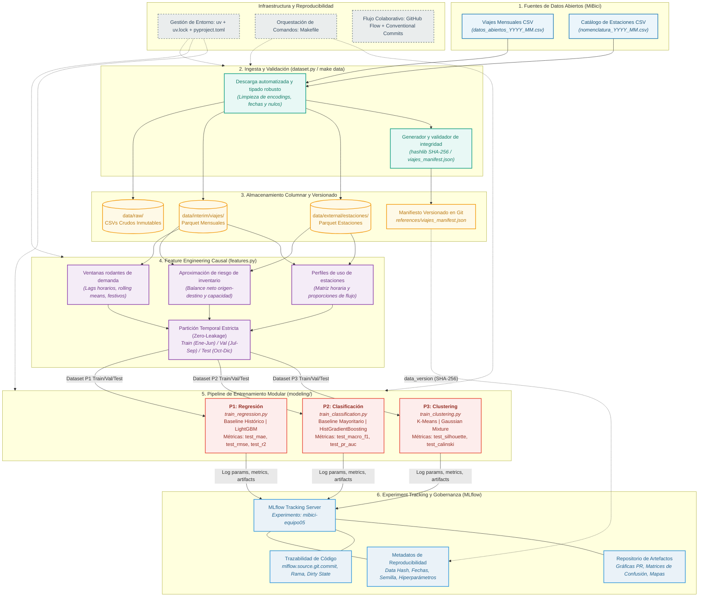

# Arquitectura del Sistema de Machine Learning — Proyecto MiBici
**Equipo 05** | TC5061 Proyecto Integrador: Primera Entrega (Parte A.5)

---

## 1. Resumen Ejecutivo de la Arquitectura

Para responder a las tres preguntas operativas del sistema de bicicleta pública MiBici (P1: Predicción de demanda futura, P2: Detección de riesgo de desabasto/saturación de estaciones, y P3: Agrupamiento no supervisado de patrones de uso), el Equipo 05 diseñó e implementó una **arquitectura de Machine Learning modular, desacoplada y orientada a producción**.

El sistema cubre el ciclo de vida completo de los datos y modelos, desde la ingesta de archivos crudos del portal de datos abiertos hasta el registro de experimentos, gobernanza y versionado de artefactos. La solución prioriza tres principios rectores de MLOps:
1. **Reproducibilidad determinista:** Cualquier integrante o auditor puede clonar el repositorio y reconstruir exactamente los mismos datos, particiones y experimentos con un único comando.
2. **Causalidad estricta (Zero Data Leakage):** Ningún cálculo de ingeniería de características, agregación temporal o ajuste de modelos utiliza información cronológicamente posterior al punto de predicción.
3. **Auditabilidad y Linaje Completo:** Cada corrida de experimento queda vinculada bidireccionalmente con el *commit* exacto de Git, el *hash* criptográfico SHA-256 de los datos de entrada, los hiperparámetros, las métricas prefijadas por partición temporal y los gráficos de diagnóstico.

---

## 2. Diagrama de Arquitectura End-to-End

El diagrama general de la arquitectura se encuentra vectorizado en [`references/arquitectura_sistema.svg`](arquitectura_sistema.svg) y especificado formalmente en lenguaje Mermaid en [`references/arquitectura_sistema.mmd`](arquitectura_sistema.mmd).

---

## 3. Desglose de Componentes y Herramientas Seleccionadas

### 3.1. Fuentes de Datos
* **Descripción:** Portal de datos abiertos de MiBici (Área Metropolitana de Guadalajara). Publica dos conjuntos heterogéneos: registros mensuales de viajes en archivos CSV (`datos_abiertos_AAAA_MM.csv`) y el catálogo de estaciones (`nomenclatura_AAAA_MM.csv`).
* **Reto técnico:** Variaciones en encodings (UTF-8 vs. Latin-1 / ISO-8859-1), nombres de columnas dispares entre períodos y tipos de datos inconsistentes (fechas como strings, identificadores con nulos o ceros a la izquierda).

### 3.2. Ingesta y Validación (`dataset.py`)
* **Herramientas:** Python 3.12+, `requests`, `pandas`, `hashlib` (biblioteca estándar).
* **Función:**
  1. Automatiza la descarga idempotente desde la terminal (`make data`).
  2. Estandariza esquemas: renombra columnas canónicamente (`viaje_id`, `origen_fecha`, `destino_fecha`, `origen_estacion_id`, `destino_estacion_id`, `usuario_genero`, `usuario_edad`).
  3. Convierte marcas temporales a `datetime64[ns]` y variables categóricas / discretas a enteros de precisión fija (`int32`).
  4. Genera un manifiesto criptográfico (`references/viajes_manifest.json`) que registra para cada archivo descargado su tamaño en bytes, conteo exacto de filas y resumen criptográfico SHA-256. Proporciona el comando de verificación `python dataset.py manifest --check`.

### 3.3. Almacenamiento Columnar y Versionado
* **Herramientas:** Apache Parquet (mediante `pyarrow` / `fastparquet`), Git (para metadatos).
* **Función:**
  1. Los datos crudos inmutables residen en `data/raw/` (excluidos de Git por `.gitignore`).
  2. Los datos limpios se serializan en `data/interim/viajes/` en formato Apache Parquet por partición mensual.
  3. Parquet reduce el tamaño en disco en más de un 70% frente a CSV gracias a la compresión Snappy/ZSTD y permite lecturas selectivas por columna (*column projection*) y filtros por partición (*predicate pushdown*).
  4. El versionado de datos se desacopla del almacenamiento físico: el archivo `references/viajes_manifest.json` viaja en el control de versiones de Git, actuando como un contrato inmutable de datos.

### 3.4. Procesamiento e Ingeniería de Características (`features.py`)
* **Herramientas:** `pandas`, `numpy`, `scikit-learn` (transformadores y preprocesadores).
* **Función:**
  1. **P1 (Demanda):** Agregación de viajes por estación y hora ($Y_{s,t}$), generación de *lags* temporales ($t-1, t-2, \dots, t-24$), medias móviles rodantes de 24 horas y 7 días, codificación cíclica de hora y día de semana (seno/coseno) y calendario de días feriados oficiales en México.
  2. **P2 (Riesgo de Estación):** Construcción del proxy de riesgo operativo a partir del balance neto horario $(\text{Salidas} - \text{Entradas})$ normalizado por la capacidad total de la estación ($C_s$), etiquetando como estado crítico ($1$) las situaciones de estrés operativo sostenido.
  3. **P3 (Clustering):** Matriz de perfiles de uso por estación basada en la distribución de viajes por franja horaria (puntas matutinas, puntas vespertinas, valles), ratio de uso fin de semana vs. laborable y centralidad espacial.
  4. **Partición Causal:** División temporal estricta:
     - **Entrenamiento (*Train*):** Enero a Junio 2024.
     - **Validación (*Validation*):** Julio a Septiembre 2024.
     - **Prueba (*Test*):** Octubre a Diciembre 2024.
     Se prohíbe cualquier partición aleatoria (*random shuffle*), garantizando que las predicciones se evalúen siempre hacia el futuro (*out-of-time evaluation*).

### 3.5. Modelado y Entrenamiento Modular (`modeling/`)
* **Herramientas:** `scikit-learn`, `LightGBM`.
* **Función y Desacoplamiento:**
  Cada pregunta dispone de su propio script de entrenamiento ejecutable (`train_regression.py`, `train_classification.py`, `train_clustering.py`), evitando colisiones de desarrollo y permitiendo la experimentación concurrente:
  - **P1 (Regresión):** Baseline de persistencia histórica vs. `LightGBMRegressor` / `HistGradientBoostingRegressor`. Métricas: `test_mae`, `test_rmse`, `test_r2`.
  - **P2 (Clasificación):** Baseline mayoritario / Regresión Logística con balanceo de pesos vs. `HistGradientBoostingClassifier`. Métricas: `test_macro_f1`, `test_pr_auc`, `test_balanced_accuracy`.
  - **P3 (Clustering):** Baseline K-Means ($k=3$) vs. K-Means optimizado / Gaussian Mixture Models. Métricas: `test_silhouette_score`, `test_calinski_harabasz`.

### 3.6. Registro, Trazabilidad y Gobernanza (MLflow Tracking)
* **Herramientas:** MLflow Tracking (`mlflow`).
* **Función:**
  1. Centralización en el experimento institucional `mibici-equipo05`.
  2. Parámetros auditables: versión criptográfica de los datos (`data_version`), rango de fechas, semilla aleatoria (`random_seed=42`), hiperparámetros de modelo.
  3. Métricas estandarizadas con prefijo de partición (`train_*`, `val_*`, `test_*`).
  4. Etiquetas automáticas de auditoría: `team: equipo05`, `question: P1|P2|P3`, `mlflow.source.git.commit`, `mlflow.source.git.branch` y estado de limpieza del árbol de trabajo (`git_dirty_state`).
  5. Registro de artefactos explicativos: curvas Precision-Recall, matrices de confusión etiquetadas en español, mapas de clusters de estaciones y gráficas de residuos temporales.

### 3.7. Infraestructura, Entornos y Orquestación
* **Herramientas:** `uv` (Astral), `Makefile`, Git / GitHub (GitHub Flow).
* **Función:**
  - `uv` garantiza resolución e instalación ultrarrápida y determinista de dependencias mediante el archivo de bloqueo `uv.lock`.
  - `Makefile` estandariza el flujo operativo de los desarrolladores (`make data`, `make test`, `make lint`), abstrayendo llamadas complejas.
  - La rama principal protegida en GitHub asegura que ningún cambio se integre sin un *Pull Request* revisado por pares.

---

## 4. Justificación Teórica Formal Vinculada a las Lecturas

La selección de cada componente y herramienta responde directamente a las directrices de la literatura canónica de MLOps:

### 4.1. Marco de Chip Huyen (2022) — *Designing Machine Learning Systems*
1. **Desacoplamiento de Almacenamiento y Cómputo (Cap. 3):**
   Huyen enfatiza que los sistemas de ML modernos deben separar el almacenamiento inmutable de la capa de procesamiento. La elección de **Apache Parquet** sobre CSV no es cosmética: Parquet proporciona compresión basada en diccionarios y codificación por longitud de corridas (RLE), optimizando las operaciones de agregación columnar necesarias en series temporales y minimizando los tiempos de E/S en disco.
2. **Prevención de Data Leakage y Validación Causal (Cap. 4 y 5):**
   Huyen cataloga la fuga de datos (*data leakage*) como uno de los errores más costosos y comunes en ML. Se produce cuando información del futuro o del conjunto de prueba contamina el entrenamiento. Nuestra arquitectura resuelve esto en dos niveles:
   - *Partición estrictamente temporal:* Los cortes se basan en ventanas cronológicas cerradas (Ene-Jun / Jul-Sep / Oct-Dic 2024), nunca en muestreo aleatorio.
   - *Transformadores sin estado o ajustados exclusivamente en Train:* Los preprocesadores (escaladores, codificadores, medias históricas) aprenden sus parámetros únicamente con la partición de entrenamiento, impidiendo que estadísticas del conjunto de prueba filtren información previa.
3. **Reproducibilidad y Registro de Experimentos (Cap. 6):**
   Un modelo no es simplemente su arquitectura de pesos; es la combinación indisociable de **código + datos + hiperparámetros + entorno**. Siguiendo a Huyen, el uso de MLflow Tracking junto con `uv.lock` y el hash SHA-256 de los datos garantiza que cualquier experimento pueda reconstruirse de manera determinista en el futuro.

### 4.2. Marco de Treveil et al. (2020) — *Introducing MLOps: How to Scale Machine Learning in the Enterprise*
1. **El Teorema de la Deuda Técnica Oculta (Cap. 1 y 2):**
   Treveil et al. retoman el principio seminal de Sculley et al. (2015), demostrando que el código puramente de ML representa menos del 10% de un sistema real; el 90% restante consiste en infraestructura de ingesta, verificación de esquemas, extracción de características y monitoreo. Nuestra arquitectura distribuye el esfuerzo en pipelines modulares (`dataset.py`, `features.py`, `common.py`) que minimizan el código espagueti y garantizan interfaces estables entre etapas.
2. **Gobernanza y Linaje de Modelos (Cap. 3 y 4):**
   Treveil et al. establecen que para que un modelo sea gobernable en una organización, debe ser auditable: debe existir una cadena de custodia ininterrumpida que conecte una predicción en producción con los datos que la originaron y el responsable del cambio. Las etiquetas automáticas de MLflow (`mlflow.source.git.commit`, `git_dirty_state`, `data_version`) satisfacen este estándar corporativo de auditabilidad.

### 4.3. Marco de Benjamin Wilson (2022) — *Machine Learning Engineering in Action*
1. **Ingeniería Defensiva y Contratos de Datos (Cap. 2 y 4):**
   Wilson postula que el software de ML debe ser defensivo frente a fuentes externas. Dado que los portales abiertos pueden alterar formatos, nombres de columnas o contener datos corruptos, nuestro script `dataset.py` implementa validaciones explícitas de tipos y el control criptográfico por manifiesto SHA-256. Si los datos cambian o se corrompen, el pipeline falla de forma temprana y controlada (*fail-fast*), antes de alimentar los modelos.
2. **La Disciplina del Baseline Obligatorio (Cap. 6 y 7):**
   Wilson advierte contra la tendencia de aplicar modelos complejos (redes neuronales, ensembles pesados) sin antes medir el desempeño de un *baseline* elemental. En nuestro diseño, cada pregunta implementa un baseline transparente (media histórica en P1, clasificador mayoritario en P2, K-Means $k=3$ en P3). Cualquier mejora aportada por modelos avanzados (como LightGBM o HistGradientBoosting) se cuantifica estrictamente contra esta línea base.
3. **Métricas Alineadas con la Decisión de Negocio (Cap. 7):**
   Wilson destaca que optimizar métricas estándar desalineadas (como *Accuracy* en datasets desbalanceados) genera fallas críticas en producción. Para P2 (riesgo de desabasto), donde los eventos críticos son minoritarios, el sistema optimiza **Precision-Recall AUC (PR-AUC)** y **Macro F1-Score**, garantizando que el equipo de rebalanceo no sufra de alertas falsas masivas ni omisiones de desabasto.

---

## 5. Matriz Comparativa de Decisiones de Diseño

| Componente | Opción Descartada | Opción Elegida | Justificación Técnica & Teórica |
| :--- | :--- | :--- | :--- |
| **Almacenamiento** | Archivos CSV planos en disco | **Apache Parquet particionado** | Parquet reduce el almacenamiento >70%, acelera lecturas columnares y preserva metadatos y tipos de datos nativos sin ambigüedad (Huyen, 2022). |
| **Versionado de Datos** | DVC / Git LFS / Copia manual | **Manifiesto SHA-256 en Git (`viajes_manifest.json`)** | Mecanismo ligero, sin infraestructura externa compleja; auditable directamente en el historial de Git e integrado a MLflow (Wilson, 2022). |
| **Partición Temporal** | K-Fold aleatorio / train_test_split | **Split Temporal Secuencial (Ene-Jun / Jul-Sep / Oct-Dic)** | Evita la fuga de datos (*data leakage*) hacia el pasado y replica fielmente el escenario operativo real (Huyen, 2022; Treveil et al., 2020). |
| **Estructura de Código** | Un único script / Notebook monolítico | **Módulos separados (`dataset.py`, `features.py`, `modeling/`)** | Código testeable, mantenible, con responsabilidades segregadas y reproducible desde CLI (Wilson, 2022). |
| **Gestión de Entorno** | `pip freeze > requirements.txt` suelto | **`uv` con `pyproject.toml` y `uv.lock`** | Resolución de dependencias determinista a nivel de sub-dependencias en milisegundos; elimina inconsistencias entre sistemas operativos. |
| **Experiment Tracking** | Bitácora en hojas de cálculo / prints | **MLflow Tracking Server** | Registro inmutable de hiperparámetros, métricas por split, artefactos gráficos y commit de Git en un repositorio unificado (Treveil et al., 2020). |

---

## 6. Referencias Bibliográficas (APA 7)

* Huyen, C. (2022). *Designing machine learning systems: An iterative process for production-ready applications*. O'Reilly Media.
* Sculley, D., Holt, G., Golovin, D., Davydov, E., Phillips, T., Ebner, D., Chaudhary, V., Young, M., Crespo, J.-F., & Dennison, D. (2015). Hidden technical debt in machine learning systems. In *Advances in Neural Information Processing Systems* (Vol. 28, pp. 2503–2511). Curran Associates, Inc.
* Treveil, M., Omont, N., Stenac, C., Lefevre, K., Phan, D., Zentici, J., Lavoillotte, A., Miyazaki, M., & Heidmann, L. (2020). *Introducing MLOps: How to scale machine learning in the enterprise*. O'Reilly Media.
* Wilson, B. (2022). *Machine Learning Engineering in Action*. Manning Publications.
