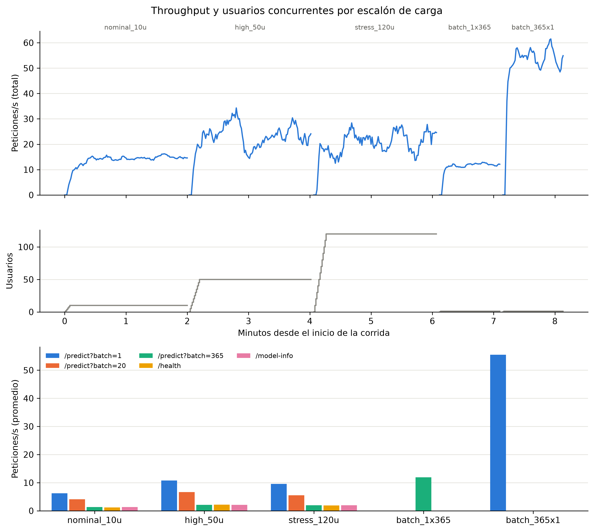
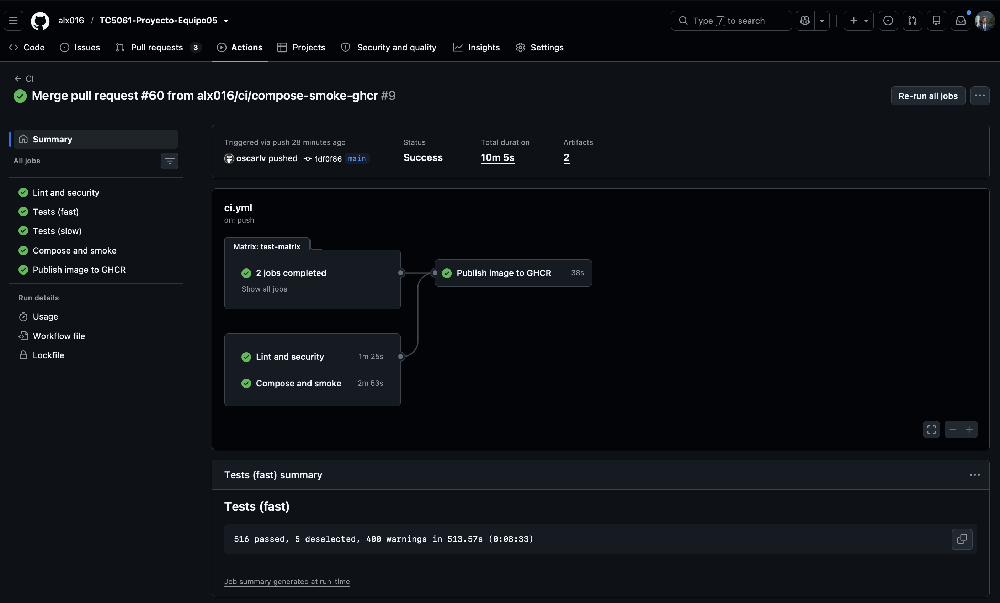

<style>
@page {
  size: letter;
  margin: 2.54cm;
}
body {
  font-family: Arial, "Liberation Sans", Helvetica, sans-serif;
  font-size: 11pt;
  line-height: 1.15;
}
</style>

# Operación, pruebas de carga y FinOps del modelo P2 (Entrega 6)

- **Proyecto:** TC5061 MLOps, Equipo 05. Datos abiertos de MiBici.
- **Repositorio:** <https://github.com/alx016/TC5061-Proyecto-Equipo05> (orquestación en
  `docker-compose.yml`, pipeline en `.github/workflows/ci.yml`, pruebas de carga en `load_tests/`).
- **Sistema evaluado:** API de P2, riesgo de desabasto o saturación por estación
  (`mibici-equipo05-p2-riesgo`, champion v3), con el servidor de MLflow de la Entrega 2.
- **Fecha:** 22 de noviembre de 2026.

<!--
Guía del esqueleto (WP-0). Borrar este comentario en WP-D.

- Formato del PDF: Arial 11 (o Liberation Sans / Helvetica), interlineado 1.15.
- Cuerpo (Resumen a Referencias): de 3 a 5 cuartillas. Los Anexos no cuentan.
- Presupuesto por sección, en páginas: Resumen 0.4, Sec. 1 0.8, Sec. 2 0.6, Sec. 3 1.2,
  Sec. 4 1.3, Sec. 5 0.5. Total: 4.8.
- Cada quien edita solo su bloque. El responsable está en el comentario de cada sección.
- Figuras en reports/figures/entrega6/ (las genera scripts/plot_load_and_finops.py).
- Tablas largas, YAML completo y logs van a los Anexos.
-->

## Resumen

<!-- Manuel (WP-D). ~0.4 pág. Qué se construyó, CI en verde, RPS sostenibles, costo por
inferencia actual y optimizado, y la recomendación principal. Se escribe al final. -->

## 1. Arquitectura y orquestación con Docker Compose

<!-- Fernando (WP-1c). ~0.8 pág.
- Topología: servicios `api` y `mlflow`, red `mibici-net`, volumen `mlflow_data`.
- Variables de entorno, healthchecks, `depends_on: service_healthy` y límites de CPU/RAM.
- Un solo comando desde un clon limpio (fallback a `models/p2-champion-v3.zip`).
- Modos de carga del modelo: bundle local por defecto y `models:/...@champion` vía MLflow.
- Por qué no se usa Redis + RQ.
- Detalle en el Anexo A.1. -->

## 2. CI/CD con GitHub Actions

El workflow `.github/workflows/ci.yml` tiene tres disparadores: push a `main`, PR hacia `main` y ejecución manual (`workflow_dispatch`). En todos se corren las validaciones de lint y seguridad, pruebas y Compose (detalle en la tabla); `publish-image` solo corre en push a `main`. Con `concurrency` y `cancel-in-progress: true`, cada push nuevo a la misma rama cancela el run anterior para no gastar minutos en código viejo. Siguiendo el **principio de mínimo privilegio**, el workflow tiene `contents: read` por defecto y solo el job de publicación recibe `packages: write`; no se usan secretos propios, solo el `GITHUB_TOKEN` que GitHub genera en cada run. Así, ningún job puede modificar el repo ni publicar paquetes sin haber pasado todas las validaciones.

| Job | Qué valida y cómo | Qué falla atrapa |
|:---|:---|:---|
| `lint-and-security` | `make lint`: formato y errores estáticos (`ruff`); `make security`: `bandit` (código propio), `pip-audit` (dependencias) y `detect-secrets` (todo el repo). | Código mal formateado o con errores estáticos; código inseguro; librerías con vulnerabilidades conocidas (CVE); credenciales commiteadas. |
| `test-matrix` | La suite de pytest se divide en dos jobs paralelos con marcadores: `slow` (suites de DeepChecks) y `not slow` (todo lo demás); `fail-fast: false` permite que ambos terminen aunque uno falle; `make prepare-model` descomprime `models/p2-champion-v3.zip` en `models/p2-riesgo/`. | Regresiones en la lógica (contrato de la API, features, entrenamiento, cálculo FinOps); problemas de integridad o drift en los datos (DeepChecks); que la API deje de ser compatible con el champion real, lo que sin el bundle se reportaría como *skip* (falso verde) en lugar de fallo. |
| `compose-and-smoke` | Construye las dos imágenes de `docker-compose.yml` (`api` y `mlflow`); levanta el stack con `docker compose up --wait`, que espera a que pasen los healthchecks; `make compose-smoke` prueba `/health` de MLflow y `/model-info`, `/health` y `/predict` de la API; verifica que se sirva `mibici-equipo05-p2-riesgo` en su versión 3. | Errores de red, variables de entorno, healthchecks o un `Containerfile` roto; que la API sirva otro modelo o una versión equivocada. |
| `publish-image` | Depende (`needs`) de los tres jobs anteriores y solo corre en push a `main` (`if`); publica `ghcr.io/alx016/mibici-p2-api` con dos tags: `latest` y el SHA del commit. | No detecta errores, los previene: evita que una imagen que no pasó lint, pruebas o el smoke test llegue a GHCR y alguien la despliegue. El tag por SHA da trazabilidad (imagen ↔ commit) y permite hacer rollback si la versión nueva falla. |

La caché acelera los runs al no reconstruir lo que no cambió: dependencias de Python (incluido el entorno de DeepChecks) con uv y capas de Docker con Buildx. `compose-and-smoke` y `publish-image` comparten la caché de la imagen `api`, así que la publicación reutiliza sus capas: en el run [`44657398679`](https://github.com/alx016/TC5061-Proyecto-Equipo05/actions/runs/44657398679) de `main`, la imagen se construyó en 25 s con el 50% de las capas en caché.

Ese run pasó en verde en ~10 min (capturas en el Anexo A.2). La ruta crítica es `Tests (fast)` (~9.3 min) seguido de `publish-image` (38 s): para acelerar el pipeline habría que acelerar `fast`, porque optimizar los otros jobs no cambiaría el tiempo total.

El pipeline cubre CI y **entrega continua**, pero no despliegue continuo: nada se despliega automáticamente a un servidor. Las pruebas de Locust (Sección 3) tampoco corren en CI por su duración y porque en runners compartidos los resultados varían según la máquina virtual, lo que haría poco confiable el cálculo FinOps (Sección 4).

## 3. Pruebas de carga con Locust y uso de recursos

El modelo P2 predice por hora las **365 estaciones activas** de MiBici (`POST /predict` admite de 1 a 500 instancias). En `load_tests/locustfile.py`, el escenario **`mixed`** (`wait_time` de `0.2` a `1.0 s`) combina consultas unitarias (`@task(5)`, `batch=1`), zonales (`@task(3)`, `batch=20`), de red completa (`@task(1)`, `batch=365`) y lecturas `/model-info` y `/health` (`@task(1)`), validando HTTP `200` y longitud exacta de `predictions`. Además, **`batch_1x365`** y **`batch_365x1`** (1 usuario, sin pausa) contrastan el envío por lote completo frente a peticiones individuales. La corrida oficial en Linux Docker (`mibici-api`: `1.0` vCPU, `1,024 MiB`; `mibici-mlflow`: `0.5` vCPU, `512 MiB`) con `docker stats` cada `1.5 s` (`scripts/collect_load_metrics.py`) registró **0 fallos (0.00%)** y `OOMKilled=false` en los 6 escenarios (**Anexo B**).



**Figura 1.** Throughput (RPS) y usuarios concurrentes por escalón (arriba) y endpoint (abajo). En carga mixta, `nominal_10u` sostiene `14.26 req/s` (`583.8 pred/s`), `high_50u` alcanza el techo HTTP de `23.82 req/s` (`917.4 pred/s`) y `stress_120u` cae a `20.95 req/s` (`830.0 pred/s`); por lotes, `batch_1x365` logra `11.94 req/s` (`4,358.1 pred/s`) frente a `55.48 req/s` (`55.5 pred/s`) en `batch_365x1`.


**Figura 2.** Latencias (`p50`/`p95`/`p99`), `p95` por tamaño de lote y tasa de error (`0.0%` en todos los casos). En `nominal_10u` la mediana es `38 ms` (`p95=320 ms`, `p99=810 ms`; `batch=365`: `p50=120 ms`, `p95=710 ms`), pero al saturar CPU sube a `p50=1,300 ms` (`p95=2,800 ms`) en `high_50u` y a `p50=4,600 ms` (`p95=7,700 ms`, `p99=8,300 ms`) en `stress_120u`.


**Figura 3.** CPU y RAM observadas en `docker stats`. El cuello es puramente de cómputo en `api` (`1.8%` en `baseline`, `47.8%` en `nominal_10u`, `99.2%` en `high_50u`, `100.5%` en `stress_120u`), mientras su RAM sube apenas de `241.3 MiB` a `293.9 MiB` máx. (`28.7%` de `1,024 MiB`) y `mlflow` permanece casi inactivo (`3.1%–4.0%` CPU, `~374 MiB` / `73%` de `512 MiB`).

**Interpretación y áreas de mejora.** La rodilla de saturación ocurre entre `10` y `50` usuarios: `nominal_10u` cumple `CPU <= 80%` con `0%` de error, pero con `50` usuarios la única vCPU de `api` satura y con `120` usuarios la mediana crece `3.5x` (`4.6 s`) y los RPS caen `12%`. En `tc5061_proyecto_equipo5/api/main.py` y `model.py`, `predict_risk` es síncrona (hilos AnyIO bajo 1 worker Uvicorn en `Containerfile`) y en cada llamada reconstruye un `pd.DataFrame` con `astype(SIGNATURE_DTYPES)` para `mlflow.pyfunc`, provocando contención del GIL y competencia de hilos OpenMP en LightGBM. Cuatro mejoras atacan estos cuellos: (1) agrupar en lotes (`batch_1x365` multiplica `78.56x` las `pred/s` frente a `batch_365x1`); (2) retirar `mlflow` en inferencia (`--no-deps api`, liberando `~374 MiB` y `0.5` vCPU); (3) invocar el `Booster` con `numpy` sin DataFrame (`opt3_benchmark.json`: `20.37x` en `batch=1`, `4.31x` en `batch=20` y `1.61x` en `batch=365` con `max_prob_diff=0.0`; 1 hilo acelera `batch=1` a `54.91x` pero degrada `batch=365` a `0.45x`); y (4) escalar workers Uvicorn con vCPUs.

## 4. Análisis FinOps

**Parámetros base y armonización mensual (730 h/mes).** Siguiendo `scripts/finops_calc.py` y la facturación AWS de `730 h/mes` (`2,628,000 s/mes`), la instancia de referencia AWS EC2 `t3.small` (`us-east-1`, 2 vCPU, 2 GiB) cuesta `$0.0208/h` (`$15.18/mes`) más `10 GB` EBS `gp3` a `$0.08/GB-mes` (`$0.80/mes`), sumando **`$15.98 USD/mes`** (`$16.78/mes` con `20 GB`), más `$0.05/vCPU-h` por *burst* sobre la línea base del `20%` (`0.4` vCPU; Amazon Web Services, 2026a, 2026b, 2026c). La demanda real armonizada de MiBici es `365 estaciones × 730 h/mes =` **`266,450 predicciones/mes`** (`~8,760/día`, **Anexo C**).

**Tres regímenes de costo (`finops_summary.json`).** (1) **Pico sostenible (`nominal_10u`):** mayor rendimiento con error `<= 1%` y CPU `api <= 80%` (`14.26 req/s`, `583.8 pred/s`, `0.5125` vCPU; `+$0.005627/h` de créditos = `$0.02643/h`), equivalente a **`$5.15×10⁻⁷/req`**, **`$1.26×10⁻⁸/pred`** y **`$0.01258 USD/1M pred`**. (2) **Operación real 24/7:** pagar `$15.98/mes` para `266,450 pred/mes` equivale a **`$59.99 USD/1M pred`** (`4,769x` el costo pico, al quedar ociosa `99.84%` del mes en `batch=1` y `99.998%` en `batch=365`). (3) **Atribución por servicio en el pico:** promediando CPU y RAM en `nominal_10u`, **`api` explica 66.5%** (`$10.63/mes`) y **`mlflow` 33.5%** (`$5.35/mes`).


**Figura 4.** Costo por 1M de predicciones frente a su línea base: arriba, optimizaciones de capacidad (pico, `$0.0126`); abajo, *scale-to-zero* sobre demanda real 24/7 (`$59.99`).

**Optimizaciones cuantificadas y comparativa *scale-to-zero*.** Frente al pico (`$0.01258/1M`), **Opt 1 (`batch_1x365`)** alcanza `4,358.1 pred/s` y baja el costo a **`$0.00315/1M`** (`74.95%` de ahorro vs. pico mixto; `98.65%` vs. unitario `$0.2332/1M`); **Opt 2 (`--no-deps api`)** elimina el `33.49%` atribuido a `mlflow` (`$0.008364/1M`, `$10.63/mes`); y **Opt 3 (`Booster` + `numpy`)**, con el speedup conservador de `batch=365` (`1.61x`), lo reduce a **`$0.007811/1M`** (`37.89%`). Frente al gasto real 24/7 (`$15.98/mes`), **Opt 4 (*scale-to-zero*)** factura solo el tiempo activo, logrando `< $0.01/mes` (`>99.9%` ahorro) en lote horario tanto con `p50` medido (`78 ms` lote, `16 ms` unitario) como con margen conservador (`0.5 s` / `50 ms`):

| Plataforma (`730 h/mes`, `266,450 pred/mes`) | Tarifa pública (18 nov 2026) | Lote (`730 req/mes`, USD/mes): `78 ms` / `0.5 s` | Unitario (`266,450 req/mes`, USD/mes): `16 ms` / `50 ms` | Ahorro vs. `t3.small` |
|:---|:---|---:|---:|---:|
| EC2 `t3.small` (`us-east-1`, `10 GB gp3`) | `$0.0208/h` + `$0.80/mes` + burst | `$15.98` (`99.998%` ocioso) | `$15.98` (`99.84%` ocioso) | Base (`0%`) |
| AWS Lambda (`us-east-1`, `1 GB` x86) | `$1.667e-5/GB-s` + `$0.20/1M` inv. (Amazon Web Services, 2026d) | **`$0.0011`** / `$0.0062` | **`$0.1243`** / `$0.2753` | **`99.99%`** (`99.96%`) lote; **`99.22%`** (`98.28%`) unit. |
| Cloud Run (`us-central1`, `1 vCPU/1 GiB`) | `$2.65e-5/s` + `$0.40/1M` req. (Google Cloud, 2026) | **`$0.0018`** / `$0.0100` | **`$0.2196`** / `$0.4596` | **`99.99%`** (`99.94%`) lote; **`98.63%`** (`97.12%`) unit. |

## 5. Conclusiones

<!-- Borrador de Emilio (WP-3b) sobre los bullets del equipo; cierre de Manuel (WP-D). ~0.5 pág.
Cuatro o cinco bullets: operación en un comando, CI, comportamiento bajo carga, costo y
siguiente paso. -->

- **Orquestación reproducible en un comando y respaldo por paquete inmutable.** `docker-compose.yml` despliega `mibici-api` (`1.0 vCPU`, `1024 MiB`) y `mibici-mlflow` (`0.5 vCPU`, `512 MiB`, MLflow `3.17.2` con `--allowed-hosts` y volumen `mlflow_data`) en la red `mibici-net` sincronizados mediante `depends_on` con `condition: service_healthy`. El `Containerfile` desempaqueta automáticamente `models/p2-champion-v3.zip` cuando falta el directorio local, lo que garantiza el arranque con `docker compose up -d --build` desde un clon limpio y permite alternar sin cambios de código hacia la resolución en vivo del Registry (`models:/mibici-equipo05-p2-riesgo@champion`).
- **Gobernanza automatizada de CI/CD y seguridad en GitHub Actions.** El flujo `.github/workflows/ci.yml` bloquea regresiones mediante compuertas estáticas y de seguridad (`ruff`, `bandit`, `pip-audit` y `detect-secrets`), ejecuta en paralelo la matriz de pruebas `fast` y `slow` con caché de `uv` (incluyendo DeepChecks en Python 3.12 y el contrato del paquete `v3` con `make prepare-model`), valida la pila completa con pruebas de humo en Docker Compose (`/health`, `/model-info` y `/predict`) y publica imágenes verificadas en GHCR (`ghcr.io/alx016/mibici-p2-api`).
- **Resiliencia bajo carga de 365 estaciones y perfilado de concurrencia en Locust.** Las pruebas de carga (`load_tests/locustfile.py`) y la telemetría de `docker stats` (`scripts/collect_load_metrics.py`) sobre escalones de 10, 50 y 120 usuarios concurrentes demuestran que agrupar las 365 estaciones activas de MiBici en lotes (`batch=20` y `batch=365` frente a `batch=1`) multiplica el rendimiento efectivo en predicciones por segundo. El perfilado bajo saturación identifica como cuellos de botella la contención del GIL en un único proceso Uvicorn, la construcción repetida de `pd.DataFrame` con `astype(SIGNATURE_DTYPES)` en `mlflow.pyfunc` y la competencia de hilos OpenMP en LightGBM, lo que fundamenta la ejecución directa sobre `Booster` con arreglos `numpy` (Optimización 3).
- **Eficiencia FinOps mediante procesamiento por lotes, desacoplamiento y scale-to-zero.** La demanda real de MiBici (`365` estaciones × `730 h/mes` = `266,450` predicciones/mes) deja ociosa una instancia dedicada AWS EC2 `t3.small` (`$15.98 USD/mes` con 10 GB EBS `gp3` o `$16.78 USD/mes` con 20 GB) entre el `99.49%`–`99.84%` (`batch=1`) y el `99.99%`–`99.998%` (`batch=365`) del mes. Combinar el lote horario consolidado (`730` peticiones/mes, Optimización 1) y el retiro de MLflow del camino de inferencia (`--no-deps api`, Optimización 2) con ejecución *serverless* bajo demanda (Optimización 4) reduce el gasto mensual a `$0.0011`–`$0.0062 USD/mes` en AWS Lambda y `$0.0018`–`$0.0100 USD/mes` en Google Cloud Run (`< $0.02 USD/mes`, ahorro `>99.9%`), o a `$0.12`–`$0.46 USD/mes` bajo peticiones unitarias (ahorro `97.1%` a `99.2%`, FinOps Foundation, 2026).
- **Madurez MLOps de extremo a extremo para la operación de MiBici P2.** La integración de las Entregas 1 a 6 consolida un ciclo operativo trazable que enlaza datos versionados por manifiesto y validación DeepChecks (E1 y E3), gobierno de experimentos y Model Registry en MLflow (E2), servicio contenedorizado con contratos estrictos en FastAPI y Pydantic (E4), monitoreo de *data drift* con Evidently y pruebas A/B con disparadores de reentrenamiento continuo (E5), y operación reproducible con CI/CD, pruebas de estrés y disciplina FinOps lista para producción (E6; Gift & Deza, 2021; Treveil et al., 2020; Wilson, 2022).

## Referencias

<!-- Emilio (WP-3b) completa y ordena en APA 7. Las de precios llevan fecha de consulta. -->

Amazon Web Services. (2026a). *Amazon EC2 On-Demand pricing*. Recuperado el 18 de noviembre de 2026, de https://aws.amazon.com/ec2/pricing/on-demand/

Amazon Web Services. (2026b). *Amazon EBS pricing*. Recuperado el 18 de noviembre de 2026, de https://aws.amazon.com/ebs/pricing/

Amazon Web Services. (2026c). *Burstable performance instances: Unlimited mode*. Recuperado el 18 de noviembre de 2026, de https://docs.aws.amazon.com/AWSEC2/latest/UserGuide/burstable-performance-instances-unlimited-mode.html

Amazon Web Services. (2026d). *AWS Lambda pricing*. Recuperado el 18 de noviembre de 2026, de https://aws.amazon.com/lambda/pricing/

Docker. (2026). *Docker Compose documentation* [Documentación de software]. https://docs.docker.com/compose/

FinOps Foundation. (2026). *What is FinOps?* Recuperado el 18 de noviembre de 2026, de https://www.finops.org/introduction/what-is-finops/

Gift, N., & Deza, A. (2021). *Practical MLOps: Operationalizing machine learning models*. O'Reilly Media.

GitHub. (2026). *GitHub Actions documentation* [Documentación de software]. https://docs.github.com/en/actions

Google Cloud. (2026). *Cloud Run pricing*. Recuperado el 18 de noviembre de 2026, de https://cloud.google.com/run/pricing

Locust. (2026). *Locust documentation* [Documentación de software]. https://docs.locust.io/

MLflow Project. (2026). *MLflow documentation* [Documentación de software]. https://mlflow.org/docs/latest/

Treveil, M., Omont, N., Stenac, C., Lefevre, K., Phan, D., Zentici, J., Lavoillotte, A., Miyazaki, M., & Heidmann, L. (2020). *Introducing MLOps: How to scale machine learning in the enterprise*. O'Reilly Media.

Wilson, B. (2022). *Machine learning engineering in action*. Manning Publications.

<div style="page-break-before: always"></div>

# Anexos

Los anexos amplían el cuerpo del reporte y no cuentan en la extensión.

## Anexo A.1. Docker Compose

<!-- Fernando (WP-1c). Extractos de docker-compose.yml y Containerfile*, validación con el
Registry en vivo y del modo sin MLflow (`--no-deps api`). -->

## Anexo A.2. Pipeline de CI/CD

Las capturas corresponden al run [`44657398679`](https://github.com/alx016/TC5061-Proyecto-Equipo05/actions/runs/44657398679) del workflow `CI`, disparado por el push a `main` del merge del PR #60 (commit `1df0f86`), y al paquete [`ghcr.io/alx016/mibici-p2-api`](https://github.com/alx016/TC5061-Proyecto-Equipo05/pkgs/container/mibici-p2-api) que publicó.

**Disparadores, permisos por defecto y cancelación de runs** (`.github/workflows/ci.yml`, líneas 3–16):

```yaml
on:
  push:
    branches: [main]
  pull_request:
    branches: [main]
  workflow_dispatch:

permissions:
  contents: read

concurrency:
  group: ci-${{ github.workflow }}-${{ github.ref }}
  cancel-in-progress: true
```

**Levantamiento del stack y smoke test en `compose-and-smoke`** (líneas 114–132). `--wait` espera a que los healthchecks de ambos servicios pasen; el último paso comprueba que se sirva el champion v3:

```yaml
- name: Start the stack
  run: docker compose up -d --no-build --wait --wait-timeout 180

- name: Smoke test (/health, /model-info, /predict)
  run: make compose-smoke

- name: Check the served model
  run: |
    info=$(curl -fsS http://localhost:8000/model-info)
    echo "$info"
    test "$(echo "$info" | jq -r .model_name)" = "mibici-equipo05-p2-riesgo"
    test "$(echo "$info" | jq -r .model_version)" = "3"

- name: Show container logs
  if: failure()
  run: docker compose logs --tail=200

- name: Stop the stack
  if: always()
  run: docker compose down -v
```

**Publicación condicionada en `publish-image`** (líneas 134–172, extracto). Solo corre en push a `main` tras los otros tres jobs, es el único con `packages: write` y reutiliza la caché `api`:

```yaml
publish-image:
  needs: [lint-and-security, test-matrix, compose-and-smoke]
  if: github.event_name == 'push' && github.ref == 'refs/heads/main'
  permissions:
    contents: read
    packages: write
  steps:
    # ... checkout, setup-buildx y login a ghcr.io con GITHUB_TOKEN ...
    - id: meta
      uses: docker/metadata-action@v6
      with:
        images: ghcr.io/${{ github.repository_owner }}/mibici-p2-api
        tags: |
          type=raw,value=latest
          type=sha

    - name: Build and push
      uses: docker/build-push-action@v7
      with:
        context: .
        file: Containerfile
        push: true
        tags: ${{ steps.meta.outputs.tags }}
        cache-from: type=gha,scope=api
        cache-to: type=gha,scope=api,mode=max
```



**Figura A.1.** Resumen del run `44657398679` (10 min 5 s en total). Los cinco jobs terminaron en verde y el grafo muestra que `publish-image` espera a la matriz `test-matrix`, a `lint-and-security` (1 min 25 s) y a `compose-and-smoke` (2 min 53 s). Abajo, el resumen que escribe `Tests (fast)`: 516 pruebas pasadas y 5 excluidas (las `slow`).


**Figura A.2.** Resumen del job `publish-image` del mismo run: la imagen se publicó con los tags `latest` y `sha-1df0f86`, y el build del `Containerfile` tardó 25 s con el 50% de las capas tomadas de la caché compartida `api`.


**Figura A.3.** Paquete público `mibici-p2-api` en GHCR, ligado al repositorio, con los tags `latest` y `sha-1df0f86` y el comando `docker pull` para descargar la versión exacta del commit.

## Anexo B. Resultados completos de las pruebas de carga

*Generado automáticamente el 2026-11-20T00:58:06Z desde `reports/load` (`reports/load/anexo_b.md`).*

### B.1. Métricas de Locust por escenario y endpoint

| Escenario | Método | Endpoint | Peticiones | Fallos | Error (%) | p50 (ms) | p95 (ms) | p99 (ms) | RPS |
|:---|:---|:---|---:|---:|---:|---:|---:|---:|---:|
| `nominal_10u` | `GET` | `/health` | 145 | 0 | 0.00 | 10.0 | 110.0 | 310.0 | 1.22 |
| `nominal_10u` | `GET` | `/model-info` | 161 | 0 | 0.00 | 11.0 | 180.0 | 410.0 | 1.35 |
| `nominal_10u` | `POST` | `/predict?batch=1` | 746 | 0 | 0.00 | 38.0 | 260.0 | 770.0 | 6.26 |
| `nominal_10u` | `POST` | `/predict?batch=20` | 486 | 0 | 0.00 | 42.0 | 340.0 | 630.0 | 4.08 |
| `nominal_10u` | `POST` | `/predict?batch=365` | 162 | 0 | 0.00 | 120.0 | 710.0 | 1200.0 | 1.36 |
| `high_50u` | `GET` | `/health` | 257 | 0 | 0.00 | 790.0 | 1800.0 | 2400.0 | 2.15 |
| `high_50u` | `GET` | `/model-info` | 250 | 0 | 0.00 | 1100.0 | 2500.0 | 2900.0 | 2.09 |
| `high_50u` | `POST` | `/predict?batch=1` | 1290 | 0 | 0.00 | 1300.0 | 2800.0 | 4200.0 | 10.81 |
| `high_50u` | `POST` | `/predict?batch=20` | 793 | 0 | 0.00 | 1400.0 | 2800.0 | 4300.0 | 6.64 |
| `high_50u` | `POST` | `/predict?batch=365` | 253 | 0 | 0.00 | 1800.0 | 3100.0 | 4900.0 | 2.12 |
| `stress_120u` | `GET` | `/health` | 228 | 0 | 0.00 | 3300.0 | 5800.0 | 6300.0 | 1.91 |
| `stress_120u` | `GET` | `/model-info` | 237 | 0 | 0.00 | 4500.0 | 7500.0 | 8000.0 | 1.99 |
| `stress_120u` | `POST` | `/predict?batch=1` | 1144 | 0 | 0.00 | 4700.0 | 7600.0 | 8200.0 | 9.60 |
| `stress_120u` | `POST` | `/predict?batch=20` | 656 | 0 | 0.00 | 4700.0 | 7700.0 | 8400.0 | 5.50 |
| `stress_120u` | `POST` | `/predict?batch=365` | 232 | 0 | 0.00 | 5500.0 | 8200.0 | 9200.0 | 1.95 |
| `batch_1x365` | `POST` | `/predict?batch=365` | 705 | 0 | 0.00 | 78.0 | 110.0 | 200.0 | 11.94 |
| `batch_365x1` | `POST` | `/predict?batch=1` | 3277 | 0 | 0.00 | 16.0 | 27.0 | 43.0 | 55.48 |

### B.2. Comparativa de batching (`batch_1x365` vs `batch_365x1`)

| Escenario | Tamaño lote | RPS HTTP | Predicciones/s | p50 (ms) | p95 (ms) | Factor Pred/s |
|:---|---:|---:|---:|---:|---:|---:|
| `batch_365x1` | 1 | 55.48 | 55.48 | 16.0 | 27.0 | 1.00x |
| `batch_1x365` | 365 | 11.94 | 4358.06 | 78.0 | 110.0 | 78.56x |

### B.3. Consumo de recursos de contenedores (`docker stats`)

| Escenario | Contenedor | Muestras | CPU prom (%) | CPU máx (%) | RAM prom (MiB) | RAM máx (MiB) | RAM prom (%) | PIDs máx |
|:---|:---|---:|---:|---:|---:|---:|---:|---:|
| `baseline` | `api` | 30 | 1.75 | 21.87 | 241.25 | 241.50 | 23.56 | 24 |
| `baseline` | `mlflow` | 30 | 2.97 | 39.21 | 373.71 | 384.30 | 72.99 | 21 |
| `nominal_10u` | `api` | 60 | 47.79 | 101.85 | 247.31 | 259.20 | 24.15 | 33 |
| `nominal_10u` | `mlflow` | 60 | 3.47 | 41.99 | 374.27 | 387.50 | 73.10 | 21 |
| `high_50u` | `api` | 60 | 99.16 | 109.10 | 267.02 | 282.70 | 26.08 | 65 |
| `high_50u` | `mlflow` | 60 | 3.37 | 43.68 | 373.99 | 384.70 | 73.04 | 21 |
| `stress_120u` | `api` | 60 | 100.54 | 108.15 | 280.32 | 293.90 | 27.38 | 69 |
| `stress_120u` | `mlflow` | 60 | 3.20 | 48.20 | 374.64 | 386.00 | 73.17 | 26 |
| `batch_1x365` | `api` | 31 | 94.12 | 101.85 | 277.98 | 288.00 | 27.15 | 63 |
| `batch_1x365` | `mlflow` | 31 | 3.12 | 47.31 | 374.93 | 375.30 | 73.23 | 20 |
| `batch_365x1` | `api` | 31 | 87.54 | 99.90 | 277.46 | 288.40 | 27.10 | 26 |
| `batch_365x1` | `mlflow` | 31 | 4.00 | 48.79 | 377.05 | 389.20 | 73.64 | 21 |

### B.4. Microbenchmark de sobrecarga por petición (Opt 3)

| Lote | Ruta de inferencia | Media (ms) | p50 (ms) | p95 (ms) | Predicciones/s | Aceleración |
|---:|:---|---:|---:|---:|---:|---:|
| 1 | `pyfunc_dataframe` | 10.4810 | 9.0135 | 19.5737 | 95.41 | 1.00x |
| 1 | `booster_numpy` | 0.5145 | 0.1959 | 2.8341 | 1943.72 | 20.37x |
| 1 | `booster_numpy_1thread` | 0.1909 | 0.1886 | 0.2308 | 5238.91 | 54.91x |
| 20 | `pyfunc_dataframe` | 13.8600 | 10.2022 | 26.0605 | 1443.00 | 1.00x |
| 20 | `booster_numpy` | 3.2150 | 1.4230 | 8.1398 | 6220.92 | 4.31x |
| 20 | `booster_numpy_1thread` | 2.3379 | 2.2566 | 3.0486 | 8554.61 | 5.93x |
| 365 | `pyfunc_dataframe` | 17.3909 | 15.6613 | 26.8483 | 20987.95 | 1.00x |
| 365 | `booster_numpy` | 10.8354 | 8.0723 | 22.7326 | 33686.03 | 1.61x |
| 365 | `booster_numpy_1thread` | 38.5979 | 35.1957 | 54.9231 | 9456.46 | 0.45x |

## Anexo C. Memoria de cálculo FinOps

*Generado automáticamente desde `reports/load/finops_summary.json` (`reports/load/anexo_c.md`).*

### C.1 Parámetros

| Parámetro | Valor |
|:---|:---|
| Instancia | AWS EC2 `t3.small`, $0.0208/h |
| Disco | 10 GB EBS gp3, $0.8/mes |
| Horas por mes (precio y demanda) | 730 |
| Créditos de CPU | $0.05 por vCPU-hora sobre 20% de cada vCPU |
| Demanda real | 365 estaciones × 730 h = 266,450 predicciones/mes |
| Serverless (Opt 4) | $1.667e-05/s activo + $2e-07/petición |

### C.2 Escenarios medidos

| Escenario | Peticiones/s | Predicciones/s | Error (%) | CPU api (%) | CPU mlflow (%) |
|:---|---:|---:|---:|---:|---:|
| `nominal_10u` | 14.3 | 583.8 | 0.00 | 47.8 | 3.5 |
| `high_50u` | 23.8 | 917.4 | 0.00 | 99.2 | 3.4 |
| `stress_120u` | 20.9 | 830.0 | 0.00 | 100.5 | 3.2 |
| `batch_1x365` | 11.9 | 4358.1 | 0.00 | 94.1 | 3.1 |
| `batch_365x1` | 55.5 | 55.5 | 0.00 | 87.5 | 4.0 |

Pico sostenible: `nominal_10u` (más predicciones/s con error ≤ 1% y CPU de `api` ≤ 80%).

### C.3 Cálculo

- Costo/hora en el pico = tarifa + créditos = $0.0208 + $0.005627
- Costo/petición = costo/hora / (peticiones/s × 3600) = $5.148e-07
- Costo/predicción = costo/hora / (predicciones/s × 3600) = $1.258e-08
- Costo por 1M de predicciones en el pico = $0.01258
- Costo mensual 24/7 = tarifa × 730 + disco = $15.98
- Costo por 1M de predicciones con la demanda real = costo mensual / 266,450 × 10⁶ = $59.99
- Atribución: `api` 66.5%, `mlflow` 33.5% (promedio de su parte de CPU y de memoria)

### C.4 Optimizaciones contra el pico sostenible

Línea base: $0.01258 por 1M de predicciones.

| Optimización | Costo por 1M pred. | Costo mensual | Ahorro |
|:---|---:|---:|---:|
| Batching de 365 estaciones por petición | $0.00315 | $15.98 | 74.95% |
| MLflow fuera del camino de inferencia | $0.008364 | $10.63 | 33.49% |
| Inferencia directa con el Booster y menos sobrecarga por petición | $0.007811 | $15.98 | 37.89% |

### C.5 Optimizaciones contra la operación real 24/7

Línea base: $15.98/mes, $59.99 por 1M de predicciones. Las dos escalas no son comparables entre sí.

| Optimización | Costo por 1M pred. | Costo mensual | Ahorro |
|:---|---:|---:|---:|
| Scale-to-zero con una corrida por hora | $0.00411 | $0.001095 | 99.99% |

Sin agrupar (365 peticiones de 1 estación por hora): $0.1243/mes, ahorro de 99.22%.

### C.6 Comandos de reproducción

```bash
make up && make compose-smoke
make load-test
make load-report
uv run python scripts/plot_load_and_finops.py --load-dir reports/load --output-dir reports/figures/entrega6
```

