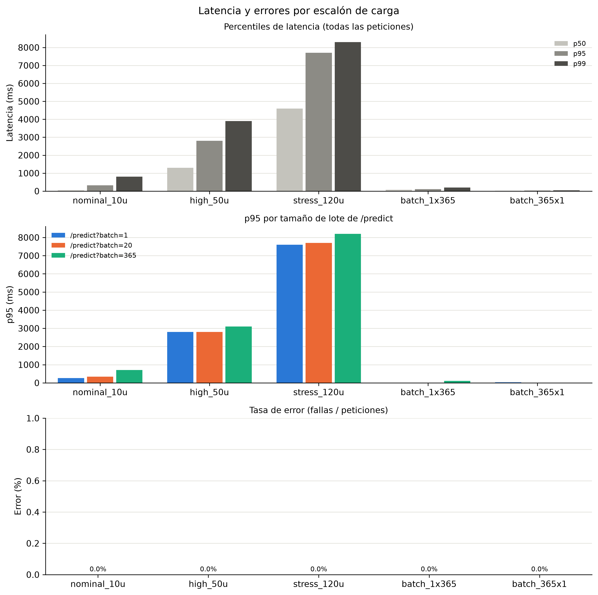
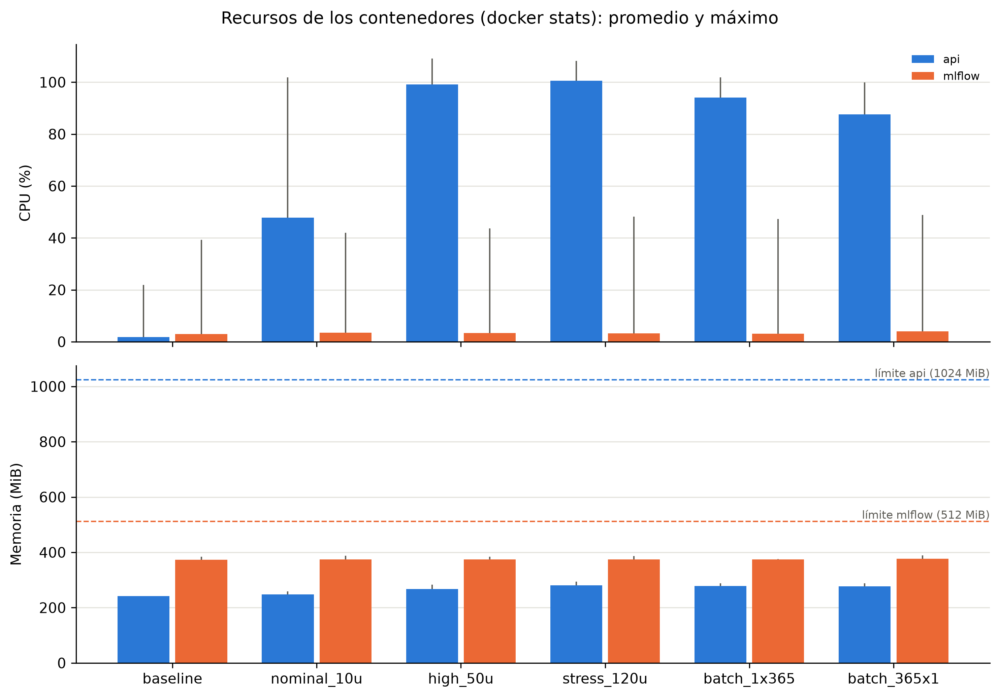
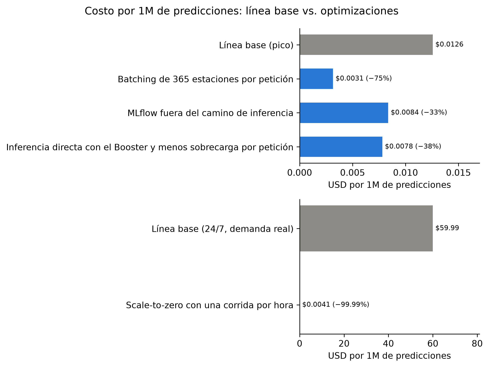
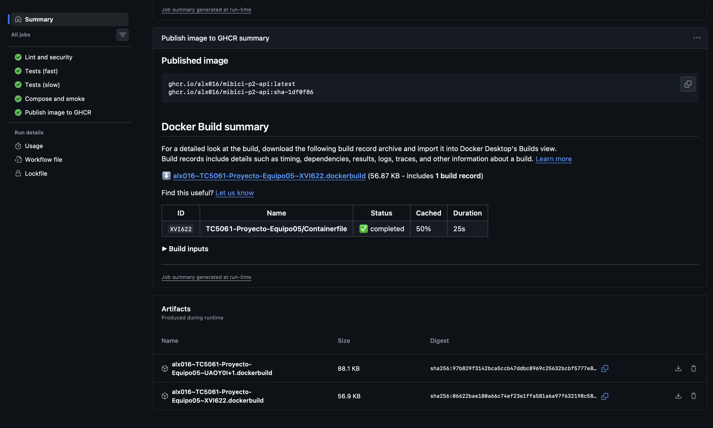
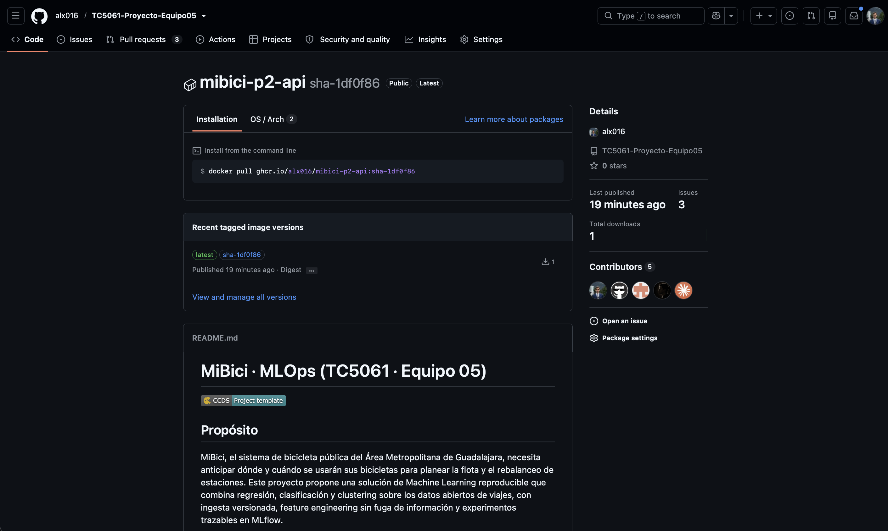

<style>
@page {
  size: letter;
  margin: 2.54cm;
}
body {
  font-family: Arial, "Liberation Sans", Helvetica, sans-serif;
  font-size: 11pt;
  line-height: 1.15;
  text-align: justify;
}
/* Espacio entre párrafos de media línea; el interlineado se queda en 1.15. */
p, ul, ol, table, pre {
  margin: 0.5em 0;
}
img {
  display: block;
  max-height: 7cm;
  margin: 0 auto;
}
/* Dos figuras lado a lado: a 7 cm de alto ya miden ~8 cm de ancho. */
.par-figuras {
  display: flex;
  gap: 0.5cm;
}
.par-figuras > div {
  flex: 1;
}
.par-figuras img {
  max-width: 100%;
}
/* Pie de figura: el párrafo que sigue a la imagen. */
p:has(> img) + p {
  font-size: 9pt;
  text-align: center;
}
</style>

# Operación, pruebas de carga y FinOps del modelo P2 (Entrega 6)

- **Proyecto:** TC5061 MLOps, Equipo 05. Datos abiertos de MiBici.
- **Repositorio:** <https://github.com/alx016/TC5061-Proyecto-Equipo05> (orquestación en
  `docker-compose.yml`, pipeline en `.github/workflows/ci.yml`, pruebas de carga en `load_tests/`).
- **Sistema evaluado:** API de P2, riesgo de desabasto o saturación por estación
  (`mibici-equipo05-p2-riesgo`, champion v3), con el servidor de MLflow de la Entrega 2.
- **Fecha:** 22 de noviembre de 2026.


## Resumen

Esta entrega convierte la API del modelo P2 de MiBici (riesgo de desabasto o saturación por estación) en un sistema operable: Docker Compose levanta la API y el servidor de MLflow con un solo comando, un pipeline de GitHub Actions prueba, construye y publica la imagen en cada cambio, y pruebas de carga con Locust alimentan un análisis FinOps del costo por inferencia. El pipeline pasó en verde en ~10 min (run `44657398679` de `main`) y publicó la imagen en GHCR (`ghcr.io/alx016/mibici-p2-api`; Anexo A.2). En las pruebas de carga no hubo **ningún error** en los 6 escenarios: con 10 usuarios la API sostiene **14.26 req/s** con la CPU bajo 80%, y con 50 su única vCPU satura cerca de **24 req/s** (Sección 3). Enviar las 365 estaciones en una sola petición da **78.56× más predicciones por segundo** que enviarlas una por una. En una AWS EC2 `t3.small`, el costo en el pico es de **$0.01258 por millón de predicciones**, pero con la demanda real (365 predicciones por hora) sube a **$59.99**, porque la instancia pasa ociosa casi todo el mes. Recomendamos servir el lote horario con *scale-to-zero* y sin MLflow en inferencia, lo que baja el gasto de **$15.98 a menos de $0.01 al mes** (Sección 4).

## 1. Arquitectura y orquestación con Docker Compose

El sistema se levanta con un solo comando desde un clon limpio: `make up` (`docker compose up -d --build`; Docker, 2026). `docker-compose.yml` define dos servicios conectados por la red *bridge* `mibici-net`:

| Servicio | Puerto | Límites | Función |
|:---|:---|:---|:---|
| `mlflow` | 5001 | 0.5 CPU, 512 MiB | Tracking Server y Model Registry (MLflow 3.17.2; MLflow Project, 2026); metadatos y artefactos en el volumen `mlflow_data` |
| `api` | 8000 | 1.0 CPU, 1024 MiB | Inferencia de P2 con FastAPI (`/health`, `/model-info`, `/predict`) |

**Red, salud y variables.** Cada servicio tiene un *healthcheck* sobre `/health`, y `api` espera a MLflow con `depends_on: condition: service_healthy`. Dentro de la red, la API llega a MLflow por su nombre: `MLFLOW_TRACKING_URI=http://mlflow:5001` va fijo para que un `.env` local con `127.0.0.1` no rompa el DNS interno, mientras que `MODEL_URI`, `API_PORT` y `MLFLOW_PORT` se configuran desde el entorno.

**Clon limpio y modos de carga.** `models/p2-riesgo/` no está en Git: si falta, el `Containerfile` descomprime `models/p2-champion-v3.zip` durante el build con `RUN --mount=type=bind`, sin copiar el zip a la imagen. Por defecto la API sirve ese bundle inmutable y no depende de MLflow (`docker compose up -d --no-deps api`, base de la Opt 2); con `MODEL_URI=models:/mibici-equipo05-p2-riesgo@champion` carga el modelo del Registry en vivo. Validación y ajuste de memoria de MLflow en el Anexo A.1.

**Sin Redis + RQ.** La demanda real son 365 predicciones por hora, que una sola petición de lote resuelve en 78 ms (Sección 3). Una cola asíncrona agregaría dos servicios y memoria sin reducir la latencia, y no cabría en la `t3.small` de referencia.

## 2. CI/CD con GitHub Actions

`.github/workflows/ci.yml` corre en cada push y PR hacia `main` y de forma manual (`workflow_dispatch`), y `concurrency` cancela el run anterior de la misma rama (GitHub, 2026). Por **mínimo privilegio**, el permiso por defecto es `contents: read`, solo `publish-image` recibe `packages: write` y no hay secretos propios, solo el `GITHUB_TOKEN` de cada run. Cuatro jobs (detalle en el Anexo A.2):

- **`lint-and-security`:** `ruff` sobre el paquete `tc5061_proyecto_equipo5`, `bandit`, `pip-audit` (CVE en dependencias) y `detect-secrets`.
- **`test-matrix`:** **matriz** de pytest en dos jobs paralelos, `fast` y `slow` (DeepChecks), con el champion real descomprimido para que su prueba falle en lugar de saltarse.
- **`compose-and-smoke`:** **valida el levantamiento con Compose** (`up --wait` hasta pasar los *healthchecks*), prueba `/health`, `/model-info` y `/predict`, y verifica que se sirva la v3.
- **`publish-image`:** solo en push a `main` y tras los otros tres, **publica** `ghcr.io/alx016/mibici-p2-api` con los tags `latest` y `sha-<commit>`, para trazabilidad y *rollback*.

La **caché** de uv (dependencias) y de Buildx (capas, compartida entre el smoke test y la publicación) evita reconstruir lo que no cambió: en el run [`44657398679`](https://github.com/alx016/TC5061-Proyecto-Equipo05/actions/runs/44657398679) de `main`, en verde en ~10 min, la imagen se construyó en 25 s con el 50% de las capas en caché. El pipeline llega a entrega continua, no a despliegue continuo, y Locust queda fuera de CI porque los *runners* compartidos dan resultados variables.

## 3. Pruebas de carga con Locust y uso de recursos

El modelo predice por hora las **365 estaciones activas** de MiBici. El escenario **`mixed`** de `load_tests/locustfile.py` (Locust, 2026; pausa de 0.2 a 1.0 s) mezcla consultas unitarias (`batch=1`, peso 5), zonales (`batch=20`, peso 3), de red completa (`batch=365`, peso 1) y lecturas de `/model-info` y `/health` (peso 1), valida HTTP 200 y el número de predicciones, y corre en escalones de 10, 50 y 120 usuarios. **`batch_1x365`** y **`batch_365x1`** (1 usuario, sin pausa) comparan un lote completo contra 365 peticiones individuales. La corrida oficial en Linux, con `docker stats` cada 1.5 s, registró **0 fallos** y ningún `OOMKilled` en los 6 escenarios (Anexo B).

<div class="par-figuras" markdown="1">
<div markdown="1">


**Figura 1.** RPS por escalón y por endpoint. `nominal_10u` sostiene 14.26 req/s y `high_50u` toca el techo de 23.82 req/s; `batch_1x365` entrega 4,358 pred/s contra 55.5 de `batch_365x1`.

</div>
<div markdown="1">



**Figura 2.** Latencias p50/p95/p99, p95 por tamaño de lote y tasa de error (0% en todos los casos). La mediana pasa de 38 ms en `nominal_10u` a 1.3 s en `high_50u` y 4.6 s en `stress_120u`.

</div>
</div>



**Figura 3.** CPU y RAM por contenedor (`docker stats`). La CPU de `api` pasa de 1.8% en reposo a 47.8% con 10 usuarios y ~100% desde 50, mientras su RAM no pasa de 294 MiB; `mlflow` se mantiene casi inactivo (3–4% de CPU, ~374 MiB).

**Interpretación y áreas de mejora.** La rodilla de saturación está entre 10 y 50 usuarios: con 10, la CPU de `api` queda bajo 80% sin errores; con 50, su única vCPU satura, y con 120 la mediana crece 3.5× (4.6 s) y los RPS caen 12%. El cuello es de cómputo, no de memoria: `predict_risk` es síncrona bajo un solo *worker* de Uvicorn y en cada llamada reconstruye un `pd.DataFrame` para `mlflow.pyfunc`, lo que genera contención del GIL y de los hilos OpenMP de LightGBM. De ahí salen tres mejoras que la Sección 4 cuantifica: agrupar en lotes (`batch_1x365` multiplica **78.56×** las predicciones por segundo), retirar `mlflow` del camino de inferencia (libera ~374 MiB y 0.5 vCPU) e invocar el `Booster` con `numpy` (20.37× más rápido en `batch=1` y 1.61× en `batch=365`, con las mismas probabilidades; Anexo B.4). Escalar los *workers* de Uvicorn también aliviaría el GIL (no cuantificado).

## 4. Análisis FinOps

La instancia de referencia es una AWS EC2 `t3.small` (`us-east-1`, 2 vCPU, 2 GiB), donde caben los 1.5 CPU y 1.5 GiB del stack: `$0.0208/h` × 730 h más 10 GB de EBS `gp3` suman **$15.98 al mes**, más $0.05 por vCPU-hora de *burst* sobre la línea base del 20% (Amazon Web Services, 2026a, 2026b, 2026c). La demanda real es de 365 estaciones × 730 h = **266,450 predicciones al mes**. El costo se mide de tres formas (FinOps Foundation, 2026; cálculo en el Anexo C):

1. **Pico sostenible** (`nominal_10u`, el mayor rendimiento con error ≤ 1% y CPU de `api` ≤ 80%): 583.8 pred/s a $0.02643/h con créditos, es decir, **$0.01258 por millón de predicciones**.
2. **Operación real 24/7:** $15.98 al mes para 266,450 predicciones equivalen a **$59.99 por millón**, 4,769× el pico, porque la instancia pasa ociosa más del 99.8% del mes.
3. **Atribución por servicio:** en el pico, `api` explica el 66.5% del costo y `mlflow` el 33.5%.



**Figura 4.** Costo por millón de predicciones contra su línea base: arriba, optimizaciones de capacidad frente al pico ($0.01258, mostrado como $0.0126); abajo, *scale-to-zero* frente a la operación real 24/7 ($59.99).

**Optimizaciones.** Contra el pico, **Opt 1** (lotes de 365) baja el costo a $0.00315 por millón (−74.95%), **Opt 2** (`--no-deps api`) elimina la parte de `mlflow` (−33.49%, $10.63 al mes) y **Opt 3** (`Booster` + `numpy`, con el *speedup* conservador de 1.61×) lo deja en $0.007811 (−37.89%). El problema de fondo, sin embargo, es la instancia ociosa, y lo resuelve **Opt 4** (*scale-to-zero*), que solo cobra el tiempo activo y es viable porque Opt 1 y 2 dejan una API sin estado ni MLflow. Con las tarifas públicas (Amazon Web Services, 2026d; Google Cloud, 2026) y la latencia mediana medida, el lote horario costaría **$0.0011 al mes en AWS Lambda** y **$0.0018 en Cloud Run** (−99.99%), y aun sin agrupar, $0.12 y $0.22 (−99.22% y −98.63%). Con margen conservador de latencia sigue en $0.01 o menos (Anexo C.6).

## 5. Conclusiones

- **Operación en un comando.** `make up` levanta API y MLflow desde un clon limpio, con red propia, *healthchecks* y un bundle que no depende del Registry.
- **CI/CD en verde.** Cada PR pasa lint, seguridad, matriz de pruebas y smoke test con Compose antes de que `main` publique en GHCR.
- **Comportamiento bajo carga.** Sin errores hasta 120 usuarios, pero con un solo *worker* la API satura su vCPU cerca de 24 req/s por la sobrecarga por petición.
- **Costo y siguiente paso.** La `t3.small` pasa ociosa casi todo el mes ($59.99 por millón con la demanda real). Recomendamos *scale-to-zero* con el lote horario y sin MLflow (menos de $0.01 al mes) y aplicar la Opt 3. Con esto se cierra el ciclo MLOps de las Entregas 1 a 6 (Gift & Deza, 2021; Treveil et al., 2020; Wilson, 2022).

## Referencias

Amazon Web Services. (2026a). *Amazon EC2 On-Demand pricing*. Recuperado el 18 de noviembre de 2026, de https://aws.amazon.com/ec2/pricing/on-demand/

Amazon Web Services. (2026b). *Amazon EBS pricing*. Recuperado el 18 de noviembre de 2026, de https://aws.amazon.com/ebs/pricing/

Amazon Web Services. (2026c). *Burstable performance instances: Unlimited mode*. Recuperado el 18 de noviembre de 2026, de https://docs.aws.amazon.com/AWSEC2/latest/UserGuide/burstable-performance-instances-unlimited-mode.html

Amazon Web Services. (2026d). *AWS Lambda pricing*. Recuperado el 18 de noviembre de 2026, de https://aws.amazon.com/lambda/pricing/

Docker. (2026). *Docker Compose documentation* [Documentación de software]. https://docs.docker.com/compose/

FinOps Foundation. (2026). *What is FinOps?* Recuperado el 18 de noviembre de 2026, de https://www.finops.org/introduction/what-is-finops/

Gift, N., & Deza, A. (2021). *Practical MLOps: Operationalizing machine learning models*. O'Reilly Media.

GitHub. (2026). *GitHub Actions documentation* [Documentación de software]. https://docs.github.com/en/actions

Google Cloud. (2026). *Cloud Run pricing*. Recuperado el 18 de noviembre de 2026, de https://cloud.google.com/run/pricing

Locust. (2026). *Locust documentation* [Documentación de software]. https://docs.locust.io/

MLflow Project. (2026). *MLflow documentation* [Documentación de software]. https://mlflow.org/docs/latest/

Treveil, M., Omont, N., Stenac, C., Lefevre, K., Phan, D., Zentici, J., Lavoillotte, A., Miyazaki, M., & Heidmann, L. (2020). *Introducing MLOps: How to scale machine learning in the enterprise*. O'Reilly Media.

Wilson, B. (2022). *Machine learning engineering in action*. Manning Publications.

<div style="page-break-before: always"></div>

# Anexos

Los anexos amplían el cuerpo del reporte y no cuentan en la extensión.

## Anexo A.1. Docker Compose

### A.1.1 Extractos

`docker-compose.yml` (servicio `api`):

```yaml
api:
  build:
    context: .
    dockerfile: Containerfile
  depends_on:
    mlflow:
      condition: service_healthy
  ports:
    - "${API_PORT:-8000}:8000"
  environment:
    MODEL_URI: ${MODEL_URI:-/app/models/p2-riesgo}
    MLFLOW_TRACKING_URI: http://mlflow:5001
  networks:
    - mibici-net
  mem_limit: 1024m
  cpus: 1.0
```

`Containerfile` (bundle del champion en un clon limpio):

```dockerfile
RUN --mount=type=bind,source=models,target=/tmp/models \
    if [ -f /tmp/models/p2-riesgo/registry_metadata.json ]; then \
        mkdir -p models && cp -r /tmp/models/p2-riesgo models/; \
    else \
        python -m zipfile -e /tmp/models/p2-champion-v3.zip .; \
    fi \
    && test -f models/p2-riesgo/registry_metadata.json
```

`Containerfile.mlflow` (servidor):

```dockerfile
ENV MLFLOW_SERVER_ENABLE_JOB_EXECUTION=false
CMD ["mlflow", "server", \
     "--backend-store-uri", "sqlite:////mlflow/mlflow.db", \
     "--artifacts-destination", "/mlflow/mlartifacts", \
     "--host", "0.0.0.0", "--port", "5001", "--workers", "1", \
     "--allowed-hosts", "mlflow:5001,mlflow,localhost:*,127.0.0.1:*"]
```

### A.1.2 Validación

| Prueba | Comando | Resultado |
|:---|:---|:---|
| Stack con Docker | `make up`, `make compose-smoke`, `make down` | MLflow *healthy* antes de la API; `/model-info` devuelve la v3 (run `7bf71250`); `/predict` responde |
| Stack con Podman | `make up COMPOSE=podman-compose` | Mismo resultado. `podman-compose` 1.0.6 no respeta `service_healthy` (usa `--requires`); no afecta en modo bundle |
| Registry en vivo | *train*, *select* y *register* contra `http://127.0.0.1:5001`; `MODEL_URI=models:/mibici-equipo05-p2-riesgo@champion docker compose up -d api` | Test idéntico al champion (`test_recall_shortage` 0.8452). `/model-info` devuelve la versión 1 (run `36dd16ec`) cargada desde `http://mlflow:5001`; `/predict` da la misma predicción que el bundle |
| API sin MLflow (Opt 2) | `docker compose up -d --no-deps api`, `make smoke` | Solo corre `mibici-api`; `/health` y `/predict` responden |
| Puerto de MLflow | `make up MLFLOW_PORT=5002` | La UI responde 200 (antes 403 por `--allowed-hosts`) |

### A.1.3 Modos de carga del modelo y memoria de MLflow

| Modo | `MODEL_URI` | Uso |
|:---|:---|:---|
| Bundle inmutable (default) | `/app/models/p2-riesgo` | La API arranca sin depender de MLflow; es el modo de producción |
| Registry en vivo | `models:/mibici-equipo05-p2-riesgo@champion` | La API descarga el modelo desde `http://mlflow:5001`; sirve para promover versiones sin reconstruir la imagen |

MLflow 3 levanta por defecto *workers* de *jobs* (~200 procesos y 1.7 GB en reposo). Con 512 MiB el *healthcheck* nunca pasaba, así que se apagaron con `MLFLOW_SERVER_ENABLE_JOB_EXECUTION=false` (el proyecto no usa *jobs*). En la corrida oficial, MLflow quedó en ~374 MiB y el stack completo en ~615 MiB en reposo (Anexo B.3), dentro de los 1.5 CPU y 1.5 GiB que caben en la `t3.small` de referencia. Una cola Redis + RQ sería útil si las predicciones tardaran minutos o llegaran en ráfagas que la API no pudiera absorber, lo que no ocurre con P2.

## Anexo A.2. Pipeline de CI/CD

Las capturas corresponden al run [`44657398679`](https://github.com/alx016/TC5061-Proyecto-Equipo05/actions/runs/44657398679) del workflow `CI`, disparado por el push a `main` del merge del PR #60 (commit `1df0f86`), y al paquete [`ghcr.io/alx016/mibici-p2-api`](https://github.com/alx016/TC5061-Proyecto-Equipo05/pkgs/container/mibici-p2-api) que publicó.

### A.2.1 Jobs del pipeline

| Job | Qué valida y cómo | Qué falla atrapa |
|:---|:---|:---|
| `lint-and-security` | `make lint`: formato y errores estáticos del paquete `tc5061_proyecto_equipo5` (`ruff`); `make security`: `bandit` (código propio), `pip-audit` (dependencias) y `detect-secrets` (todo el repo). | Código mal formateado o con errores estáticos; código inseguro; librerías con vulnerabilidades conocidas (CVE); credenciales commiteadas. |
| `test-matrix` | La suite de pytest se divide en dos jobs paralelos con marcadores: `slow` (suites de DeepChecks) y `not slow` (todo lo demás); `fail-fast: false` permite que ambos terminen aunque uno falle; `make prepare-model` descomprime `models/p2-champion-v3.zip` en `models/p2-riesgo/`. | Regresiones en la lógica (contrato de la API, features, entrenamiento, cálculo FinOps); problemas de integridad o drift en los datos (DeepChecks); que la API deje de ser compatible con el champion real, lo que sin el bundle se reportaría como *skip* (falso verde) en lugar de fallo. |
| `compose-and-smoke` | Construye las dos imágenes de `docker-compose.yml` (`api` y `mlflow`); levanta el stack con `docker compose up --wait`, que espera a que pasen los healthchecks; `make compose-smoke` prueba `/health` de MLflow y `/model-info`, `/health` y `/predict` de la API; verifica que se sirva `mibici-equipo05-p2-riesgo` en su versión 3. | Errores de red, variables de entorno, healthchecks o un `Containerfile` roto; que la API sirva otro modelo o una versión equivocada. |
| `publish-image` | Depende (`needs`) de los tres jobs anteriores y solo corre en push a `main` (`if`); publica `ghcr.io/alx016/mibici-p2-api` con dos tags: `latest` y el SHA del commit. | No detecta errores, los previene: evita que una imagen que no pasó lint, pruebas o el smoke test llegue a GHCR y alguien la despliegue. El tag por SHA da trazabilidad (imagen ↔ commit) y permite hacer rollback si la versión nueva falla. |

La ruta crítica del run es `Tests (fast)` (~9.3 min) seguido de `publish-image` (38 s): para acelerar el pipeline habría que acelerar `fast`, porque los demás jobs corren en paralelo y optimizarlos no cambiaría el tiempo total.

### A.2.2 Extractos de `ci.yml` y evidencia

**Disparadores, permisos por defecto y cancelación de runs** (`.github/workflows/ci.yml`, líneas 3–16):

```yaml
on:
  push:
    branches: [main]
  pull_request:
    branches: [main]
  workflow_dispatch:

permissions:
  contents: read

concurrency:
  group: ci-${{ github.workflow }}-${{ github.ref }}
  cancel-in-progress: true
```

**Levantamiento del stack y smoke test en `compose-and-smoke`** (líneas 114–132). `--wait` espera a que los healthchecks de ambos servicios pasen; el último paso comprueba que se sirva el champion v3:

```yaml
- name: Start the stack
  run: docker compose up -d --no-build --wait --wait-timeout 180

- name: Smoke test (/health, /model-info, /predict)
  run: make compose-smoke

- name: Check the served model
  run: |
    info=$(curl -fsS http://localhost:8000/model-info)
    echo "$info"
    test "$(echo "$info" | jq -r .model_name)" = "mibici-equipo05-p2-riesgo"
    test "$(echo "$info" | jq -r .model_version)" = "3"

- name: Show container logs
  if: failure()
  run: docker compose logs --tail=200

- name: Stop the stack
  if: always()
  run: docker compose down -v
```

**Publicación condicionada en `publish-image`** (líneas 134–172, extracto). Solo corre en push a `main` tras los otros tres jobs, es el único con `packages: write` y reutiliza la caché `api`:

```yaml
publish-image:
  needs: [lint-and-security, test-matrix, compose-and-smoke]
  if: github.event_name == 'push' && github.ref == 'refs/heads/main'
  permissions:
    contents: read
    packages: write
  steps:
    # ... checkout, setup-buildx y login a ghcr.io con GITHUB_TOKEN ...
    - id: meta
      uses: docker/metadata-action@v6
      with:
        images: ghcr.io/${{ github.repository_owner }}/mibici-p2-api
        tags: |
          type=raw,value=latest
          type=sha

    - name: Build and push
      uses: docker/build-push-action@v7
      with:
        context: .
        file: Containerfile
        push: true
        tags: ${{ steps.meta.outputs.tags }}
        cache-from: type=gha,scope=api
        cache-to: type=gha,scope=api,mode=max
```


**Figura A.1.** Resumen del run `44657398679` (10 min 5 s en total). Los cinco jobs terminaron en verde y el grafo muestra que `publish-image` espera a la matriz `test-matrix`, a `lint-and-security` (1 min 25 s) y a `compose-and-smoke` (2 min 53 s). Abajo, el resumen que escribe `Tests (fast)`: 516 pruebas pasadas y 5 excluidas (las `slow`).



**Figura A.2.** Resumen del job `publish-image` del mismo run: la imagen se publicó con los tags `latest` y `sha-1df0f86`, y el build del `Containerfile` tardó 25 s con el 50% de las capas tomadas de la caché compartida `api`.



**Figura A.3.** Paquete público `mibici-p2-api` en GHCR, ligado al repositorio, con los tags `latest` y `sha-1df0f86` y el comando `docker pull` para descargar la versión exacta del commit.

## Anexo B. Resultados completos de las pruebas de carga

*Generado automáticamente el 2026-11-20T00:58:06Z desde `reports/load` (`reports/load/anexo_b.md`).*

### B.1. Métricas de Locust por escenario y endpoint

| Escenario | Método | Endpoint | Peticiones | Fallos | Error (%) | p50 (ms) | p95 (ms) | p99 (ms) | RPS |
|:---|:---|:---|---:|---:|---:|---:|---:|---:|---:|
| `nominal_10u` | `GET` | `/health` | 145 | 0 | 0.00 | 10.0 | 110.0 | 310.0 | 1.22 |
| `nominal_10u` | `GET` | `/model-info` | 161 | 0 | 0.00 | 11.0 | 180.0 | 410.0 | 1.35 |
| `nominal_10u` | `POST` | `/predict?batch=1` | 746 | 0 | 0.00 | 38.0 | 260.0 | 770.0 | 6.26 |
| `nominal_10u` | `POST` | `/predict?batch=20` | 486 | 0 | 0.00 | 42.0 | 340.0 | 630.0 | 4.08 |
| `nominal_10u` | `POST` | `/predict?batch=365` | 162 | 0 | 0.00 | 120.0 | 710.0 | 1200.0 | 1.36 |
| `high_50u` | `GET` | `/health` | 257 | 0 | 0.00 | 790.0 | 1800.0 | 2400.0 | 2.15 |
| `high_50u` | `GET` | `/model-info` | 250 | 0 | 0.00 | 1100.0 | 2500.0 | 2900.0 | 2.09 |
| `high_50u` | `POST` | `/predict?batch=1` | 1290 | 0 | 0.00 | 1300.0 | 2800.0 | 4200.0 | 10.81 |
| `high_50u` | `POST` | `/predict?batch=20` | 793 | 0 | 0.00 | 1400.0 | 2800.0 | 4300.0 | 6.64 |
| `high_50u` | `POST` | `/predict?batch=365` | 253 | 0 | 0.00 | 1800.0 | 3100.0 | 4900.0 | 2.12 |
| `stress_120u` | `GET` | `/health` | 228 | 0 | 0.00 | 3300.0 | 5800.0 | 6300.0 | 1.91 |
| `stress_120u` | `GET` | `/model-info` | 237 | 0 | 0.00 | 4500.0 | 7500.0 | 8000.0 | 1.99 |
| `stress_120u` | `POST` | `/predict?batch=1` | 1144 | 0 | 0.00 | 4700.0 | 7600.0 | 8200.0 | 9.60 |
| `stress_120u` | `POST` | `/predict?batch=20` | 656 | 0 | 0.00 | 4700.0 | 7700.0 | 8400.0 | 5.50 |
| `stress_120u` | `POST` | `/predict?batch=365` | 232 | 0 | 0.00 | 5500.0 | 8200.0 | 9200.0 | 1.95 |
| `batch_1x365` | `POST` | `/predict?batch=365` | 705 | 0 | 0.00 | 78.0 | 110.0 | 200.0 | 11.94 |
| `batch_365x1` | `POST` | `/predict?batch=1` | 3277 | 0 | 0.00 | 16.0 | 27.0 | 43.0 | 55.48 |

### B.2. Comparativa de batching (`batch_1x365` vs `batch_365x1`)

| Escenario | Tamaño lote | RPS HTTP | Predicciones/s | p50 (ms) | p95 (ms) | Factor Pred/s |
|:---|---:|---:|---:|---:|---:|---:|
| `batch_365x1` | 1 | 55.48 | 55.48 | 16.0 | 27.0 | 1.00x |
| `batch_1x365` | 365 | 11.94 | 4358.06 | 78.0 | 110.0 | 78.56x |

### B.3. Consumo de recursos de contenedores (`docker stats`)

| Escenario | Contenedor | Muestras | CPU prom (%) | CPU máx (%) | RAM prom (MiB) | RAM máx (MiB) | RAM prom (%) | PIDs máx |
|:---|:---|---:|---:|---:|---:|---:|---:|---:|
| `baseline` | `api` | 30 | 1.75 | 21.87 | 241.25 | 241.50 | 23.56 | 24 |
| `baseline` | `mlflow` | 30 | 2.97 | 39.21 | 373.71 | 384.30 | 72.99 | 21 |
| `nominal_10u` | `api` | 60 | 47.79 | 101.85 | 247.31 | 259.20 | 24.15 | 33 |
| `nominal_10u` | `mlflow` | 60 | 3.47 | 41.99 | 374.27 | 387.50 | 73.10 | 21 |
| `high_50u` | `api` | 60 | 99.16 | 109.10 | 267.02 | 282.70 | 26.08 | 65 |
| `high_50u` | `mlflow` | 60 | 3.37 | 43.68 | 373.99 | 384.70 | 73.04 | 21 |
| `stress_120u` | `api` | 60 | 100.54 | 108.15 | 280.32 | 293.90 | 27.38 | 69 |
| `stress_120u` | `mlflow` | 60 | 3.20 | 48.20 | 374.64 | 386.00 | 73.17 | 26 |
| `batch_1x365` | `api` | 31 | 94.12 | 101.85 | 277.98 | 288.00 | 27.15 | 63 |
| `batch_1x365` | `mlflow` | 31 | 3.12 | 47.31 | 374.93 | 375.30 | 73.23 | 20 |
| `batch_365x1` | `api` | 31 | 87.54 | 99.90 | 277.46 | 288.40 | 27.10 | 26 |
| `batch_365x1` | `mlflow` | 31 | 4.00 | 48.79 | 377.05 | 389.20 | 73.64 | 21 |

### B.4. Microbenchmark de sobrecarga por petición (Opt 3)

| Lote | Ruta de inferencia | Media (ms) | p50 (ms) | p95 (ms) | Predicciones/s | Aceleración |
|---:|:---|---:|---:|---:|---:|---:|
| 1 | `pyfunc_dataframe` | 10.4810 | 9.0135 | 19.5737 | 95.41 | 1.00x |
| 1 | `booster_numpy` | 0.5145 | 0.1959 | 2.8341 | 1943.72 | 20.37x |
| 1 | `booster_numpy_1thread` | 0.1909 | 0.1886 | 0.2308 | 5238.91 | 54.91x |
| 20 | `pyfunc_dataframe` | 13.8600 | 10.2022 | 26.0605 | 1443.00 | 1.00x |
| 20 | `booster_numpy` | 3.2150 | 1.4230 | 8.1398 | 6220.92 | 4.31x |
| 20 | `booster_numpy_1thread` | 2.3379 | 2.2566 | 3.0486 | 8554.61 | 5.93x |
| 365 | `pyfunc_dataframe` | 17.3909 | 15.6613 | 26.8483 | 20987.95 | 1.00x |
| 365 | `booster_numpy` | 10.8354 | 8.0723 | 22.7326 | 33686.03 | 1.61x |
| 365 | `booster_numpy_1thread` | 38.5979 | 35.1957 | 54.9231 | 9456.46 | 0.45x |

## Anexo C. Memoria de cálculo FinOps

*Generado automáticamente desde `reports/load/finops_summary.json` (`reports/load/anexo_c.md`).*

### C.1 Parámetros

| Parámetro | Valor |
|:---|:---|
| Instancia | AWS EC2 `t3.small`, $0.0208/h |
| Disco | 10 GB EBS gp3, $0.8/mes |
| Horas por mes (precio y demanda) | 730 |
| Créditos de CPU | $0.05 por vCPU-hora sobre 20% de cada vCPU |
| Demanda real | 365 estaciones × 730 h = 266,450 predicciones/mes |
| Serverless (Opt 4) | $1.667e-05/s activo + $2e-07/petición |

### C.2 Escenarios medidos

| Escenario | Peticiones/s | Predicciones/s | Error (%) | CPU api (%) | CPU mlflow (%) |
|:---|---:|---:|---:|---:|---:|
| `nominal_10u` | 14.3 | 583.8 | 0.00 | 47.8 | 3.5 |
| `high_50u` | 23.8 | 917.4 | 0.00 | 99.2 | 3.4 |
| `stress_120u` | 20.9 | 830.0 | 0.00 | 100.5 | 3.2 |
| `batch_1x365` | 11.9 | 4358.1 | 0.00 | 94.1 | 3.1 |
| `batch_365x1` | 55.5 | 55.5 | 0.00 | 87.5 | 4.0 |

Pico sostenible: `nominal_10u` (más predicciones/s con error ≤ 1% y CPU de `api` ≤ 80%).

### C.3 Cálculo

- Costo/hora en el pico = tarifa + créditos = $0.0208 + $0.005627
- Costo/petición = costo/hora / (peticiones/s × 3600) = $5.148e-07
- Costo/predicción = costo/hora / (predicciones/s × 3600) = $1.258e-08
- Costo por 1M de predicciones en el pico = $0.01258
- Costo mensual 24/7 = tarifa × 730 + disco = $15.98
- Costo por 1M de predicciones con la demanda real = costo mensual / 266,450 × 10⁶ = $59.99
- Atribución: `api` 66.5%, `mlflow` 33.5% (promedio de su parte de CPU y de memoria)

### C.4 Optimizaciones contra el pico sostenible

Línea base: $0.01258 por 1M de predicciones.

| Optimización | Costo por 1M pred. | Costo mensual | Ahorro |
|:---|---:|---:|---:|
| Batching de 365 estaciones por petición | $0.00315 | $15.98 | 74.95% |
| MLflow fuera del camino de inferencia | $0.008364 | $10.63 | 33.49% |
| Inferencia directa con el Booster y menos sobrecarga por petición | $0.007811 | $15.98 | 37.89% |

### C.5 Optimizaciones contra la operación real 24/7

Línea base: $15.98/mes, $59.99 por 1M de predicciones. Las dos escalas no son comparables entre sí.

| Optimización | Costo por 1M pred. | Costo mensual | Ahorro |
|:---|---:|---:|---:|
| Scale-to-zero con una corrida por hora | $0.00411 | $0.001095 | 99.99% |

Sin agrupar (365 peticiones de 1 estación por hora): $0.1243/mes, ahorro de 99.22%.

### C.6 Comparativa *scale-to-zero* por plataforma

Opt 4 con la latencia mediana medida (`78 ms` por lote, `16 ms` por petición unitaria) y con un margen conservador (`0.5 s` / `50 ms`):

| Plataforma (`730 h/mes`, `266,450 pred/mes`) | Tarifa pública (18 nov 2026) | Lote (`730 req/mes`, USD/mes): `78 ms` / `0.5 s` | Unitario (`266,450 req/mes`, USD/mes): `16 ms` / `50 ms` | Ahorro vs. `t3.small` |
|:---|:---|---:|---:|---:|
| EC2 `t3.small` (`us-east-1`, `10 GB gp3`) | `$0.0208/h` + `$0.80/mes` + burst (Amazon Web Services, 2026a, 2026b, 2026c) | `$15.98` (`99.998%` / `99.99%` ocioso) | `$15.98` (`99.84%` / `99.49%` ocioso) | Base (`0%`) |
| AWS Lambda (`us-east-1`, `1 GB` x86) | `$1.667e-5/GB-s` + `$0.20/1M` inv. (Amazon Web Services, 2026d) | **`$0.0011`** / `$0.0062` | **`$0.1243`** / `$0.2753` | **`99.99%`** (`99.96%`) lote; **`99.22%`** (`98.28%`) unit. |
| Cloud Run (`us-central1`, `1 vCPU/1 GiB`) | `$2.65e-5/s` + `$0.40/1M` req. (Google Cloud, 2026) | **`$0.0018`** / `$0.0100` | **`$0.2196`** / `$0.4596` | **`99.99%`** (`99.94%`) lote; **`98.63%`** (`97.12%`) unit. |

### C.7 Comandos de reproducción

```bash
make up && make compose-smoke
make load-test
make load-report
uv run python scripts/plot_load_and_finops.py --load-dir reports/load --output-dir reports/figures/entrega6
```

