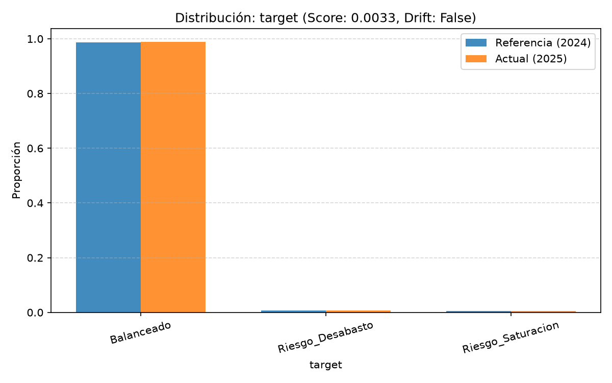
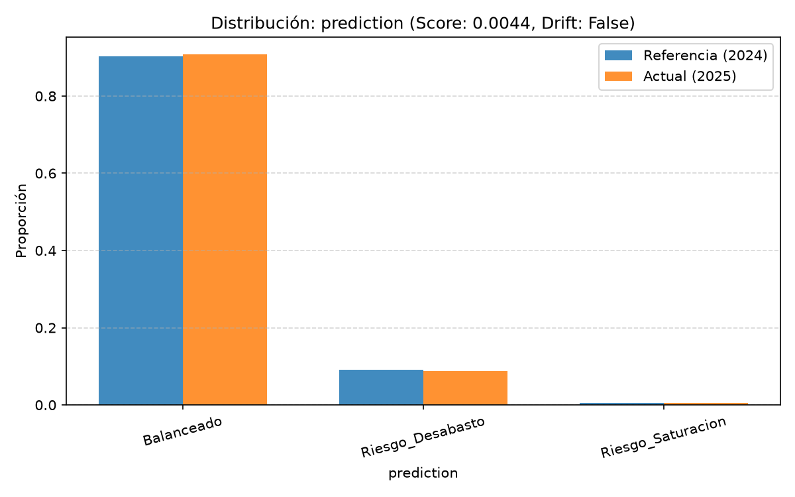

# Monitoreo del modelo P2 con Evidently y A/B testing (Entrega 5)

<!--
Esqueleto del reporte (WP-5). Cada sección tiene un dueño: edita solo la tuya, en tu propio PR,
para que los cambios no choquen. Los comentarios como este dicen qué va en cada sección y se
borran cuando la sección queda escrita.
-->

- **Proyecto:** TC5061 MLOps, Equipo 05. Datos abiertos de MiBici.
- **Modelo monitoreado:** P2 riesgo de desabasto o saturación por estación
  (`mibici-equipo05-p2-riesgo`), el mismo que sirve la API de la entrega 4.
- **Fecha:** 15 de noviembre de 2026.

## Resumen

<!--
Dueño: Manuel (WP-5). Se escribe el sábado 14, al final.
Un párrafo: qué drift se encontró, quién ganó el A/B y qué se recomienda sobre Continuous
Training. Tres o cuatro cifras clave como máximo.
-->

*Pendiente.*

## 1. Conjuntos de datos

| Conjunto | Periodo (hora objetivo) | Uso | Filas | Estaciones |
|:---|:---|:---|---:|---:|
| Referencia | 2 ene – 30 sep 2024 | Filas de `train` de P2: lo que vio el modelo al ajustarse | 2,344,900 | 358 |
| Actual | 2 ene – 30 sep 2025 | Comparación de drift contra la referencia | 2,382,355 | 365 |
| Evaluación del A/B | 1 oct – 31 dic 2025 | Evaluación de las dos versiones; ninguna lo vio | 805,920 | 365 |

Los dos conjuntos de drift empiezan el 2 de enero porque los lags del 1 de enero no tienen historia del año anterior y esas filas se descartan (8,760 en 2025: 365 estaciones x 24 horas). La referencia termina a las 22:00 del 30 de septiembre por la fecha de corte de P2. Evidently compara una muestra de 100,000 filas por conjunto, estratificada por mes, con semilla 42. De las 365 estaciones de 2025, 10 son nuevas (389 a 398) y 355 también estaban en 2024; 3 estaciones de 2024 se retiraron (20, 180 y 240).

**Por qué los mismos meses de dos años.**. Se compara enero a septiembre de 2024 contra los mismos meses de 2025. La demanda de MiBici cambia con la temporada (lluvias, vacaciones, fin de año), así que comparar meses distintos mezclaría ese efecto con el drift. Con los mismos meses, el dirft que aparezca se explica por cambios reales en la demanda o en la red, no por el calendario. 

**Por qué la referencia es solo `train`**. 
La referencia son las filas con las que se ajustó el champion, con las mismas fechas de corte del entrenamiento (`split_masks`): es exactamente lo que vio el modelo. Octubre a diciembre de 2024 se usaron para calibrar umbrales y para test, no para ajustar, así que no forman parte de lo que el modelo aprendió. 

**Por qué la evaluación queda fuera del challenger.** Octubre a diciembre de 2025 no se usó para ajustar ni para calibrar umbrales en ninguno de los dos modelos del A/B para evitar fuga de datos. El champion solo vio datos de 2024. El challenger se ajustó hasta julio de 2025 y calibró con agosto y septiembre. Una prueba del entrenamiento verifica que ninguna fila de ese periodo entra a `train` o `validation` del challenger. Además, son los mismos meses que el champion usó en 2024 (octubre y noviembre para validación, diciembre para test), así que sus métricas originales sirven de comparación sin el efecto de la temporada.

## 2. Reporte de drift

<!--
Dueño: Emilio (WP-4a). Parte del 20% de interpretación de la rúbrica.
Gráficas en reports/figures/entrega5/; HTML interactivo en reports/monitoring/.
-->

### 2.1 Configuración

La detección de drift evalúa el cambio distributivo entre el conjunto de referencia (entrenamiento de 2024) y el conjunto actual (operación de 2025). La configuración técnica implementa los lineamientos de [ADR-0003](file:///Users/emilio/Desktop/Proyectos/MNA/08-MLOps/TC5061-Proyecto-Equipo05/docs/adr/0003-distance-based-drift-detection.md).

#### Presets de Evidently

El pipeline utiliza dos presets de la biblioteca Evidently integrados en un reporte unificado:

- `DataDriftPreset`: calcula las métricas de drift por columna y a nivel de conjunto de datos para las 18 variables de entrada, la etiqueta observada (`target`) y la predicción del modelo champion (`prediction`).
- `DataSummaryPreset`: audita la calidad de los datos en ambas particiones. Evalúa conteo de filas, nulos, tipos de datos, cardinalidad y valores fuera de rango.

#### Muestreo estratificado mensual

El conjunto de entrenamiento de 2024 contiene aproximadamente 2.35 millones de registros y el periodo actual de 2025 reúne cerca de 2.5 millones. Ejecutar Evidently sobre la totalidad de los datos genera saturación de memoria, tiempos de procesamiento de varios minutos y reportes interactivos en HTML excesivamente pesados.

Para resolver este problema, la función `stratified_monthly_sample` extrae una muestra determinista de 100 000 registros por partición con semilla fija `seed=42`. El algoritmo asigna cuotas proporcionales por mes y selecciona registros sin reemplazo. Este diseño preserva la estacionalidad temporal de los nueve meses comparados y mantiene la representatividad de la red de estaciones. El tiempo de cómputo disminuye a pocos segundos y los artefactos generados son ligeros.

#### Métricas de distancia frente a pruebas de hipótesis

Las pruebas de hipótesis clásicas basadas en valores p, como Kolmogorov-Smirnov para variables continuas o Chi-cuadrada para categóricas, fallan en conjuntos masivos de datos. Al operar con muestras de $N \ge 100\,000$, la potencia estadística es extrema. Cualquier discrepancia distributiva minúscula e irrelevante en la operación práctica produce un valor p cercano a cero. Esto detonaría alertas falsas continuas en casi todas las columnas.

Conforme a ADR-0003, la configuración sustituye las pruebas de hipótesis por métricas de distancia estadística y divergencia que cuantifican la magnitud real del cambio distributivo:

- **Variables numéricas continuas (15 variables):** distancia de Wasserstein normalizada (`wasserstein`), que corresponde a la distancia $L_1$ de movimiento de tierra dividida entre la desviación estándar. El umbral operativo de drift es 0.1.
- **Variables categóricas y booleanas (`day_of_week`, `is_weekend`, `is_holiday`):** divergencia de Jensen-Shannon (`jensenshannon`). El umbral operativo de drift es 0.1.
- **Objetivo y predicción (`target`, `prediction`):** se evalúan como variables categóricas mediante divergencia de Jensen-Shannon con umbral de 0.1.

#### Criterios de decisión a nivel de conjunto

Se marca drift global del conjunto (`dataset_drift = True`) cuando la proporción de variables con drift detectado alcanza o supera el 50% (`drift_share = 0.50`). De forma complementaria, el pipeline calcula disparadores operacionales independientes en el archivo `drift_summary.json`:

- `trigger_data_drift`: se activa si más del 30% de las variables de entrada presentan drift (`DATA_DRIFT_SHARE_TRIGGER = 0.30`), o si cualquiera de las tres variables de mayor importancia del modelo (`longitude`, `latitude`, `net_flow_lag24`) supera su umbral de 0.1.
- `trigger_label_drift`: se activa si se detecta drift en la distribución del `target` o en la distribución de la `prediction`.

### 2.2 Calidad de datos

La auditoría de calidad generada por `DataSummaryPreset` confirma la integridad del esquema tabular y la consistencia en los tipos de datos en las particiones de referencia (2024) y actual (2025). No se detectaron discrepancias en los tipos de datos ni columnas faltantes respecto a la firma requerida.

#### Valores nulos y completitud

Ambas particiones exhiben una completitud superior al 99.7% en la totalidad de las columnas evaluadas:

- **Variables estáticas y de calendario:** las columnas `capacity`, `latitude`, `longitude`, `hour_sin`, `hour_cos`, `day_of_week`, `is_weekend` e `is_holiday` presentan 0% de valores nulos en ambos periodos.
- **Variables de rezago temporal (lags):** las columnas de flujo y arribos (`net_flow_lag1`, `arrivals_lag1`, `departures_lag1`, etc.) registran una cantidad reducida de valores nulos concentrados exclusivamente en las primeras horas del 1 de enero. Este comportamiento es estructural debido al arranque de las ventanas móviles de cálculo (358 nulos en lags de 1 hora, 716 en 2 horas y 8 592 en rezago de 24 horas sobre el universo total). En la muestra mensual estratificada de 100 000 filas, la proporción de nulos por lags es inferior al 0.05%.
- **Etiqueta objetivo (`target`):** contiene nulos únicamente en la última estampa temporal observada de la serie temporal, donde la etiqueta hacia adelante ($t+1$) no puede calcularse.

#### Rangos y consistencia de dominio

Las variables numéricas se mantienen dentro de los límites físicos y operativos esperados:

- **Variables geográficas:** la latitud se ubica en el intervalo $[20.636, 20.738]$ y la longitud en $[-103.425, -103.301]$. Todas las observaciones corresponden a ubicaciones válidas dentro del Área Metropolitana de Guadalajara.
- **Capacidad de estaciones:** oscila entre 11 y 39 puertos de anclaje. Refleja con exactitud la infraestructura instalada en el sistema.
- **Codificación temporal:** las componentes cíclicas `hour_sin` y `hour_cos` se conservan estrictamente acotadas en $[-1.0, 1.0]$.
- **Variables de flujo y demanda:** los arribos y salidas pasados (`arrivals_lag*`, `departures_lag*`) son no negativos ($\ge 0$). Los flujos netos normalizados (`neighbor_net_flow` y `net_flow_lag*`) presentan distribuciones simétricas alrededor de cero.

#### Comparación de valores nuevos entre 2024 y 2025

El preset audita si el conjunto actual de 2025 introduce categorías o comportamientos no observados durante el entrenamiento de 2024:

- **Variables categóricas y booleanas:** `day_of_week` (valores del 0 al 6), `is_weekend` (falso o verdadero) e `is_holiday` (falso o verdadero) presentan idéntica cardinalidad en 2024 y 2025. No existen categorías nuevas ni valores fuera de dominio.
- **Dominio de la etiqueta objetivo:** las tres clases operativas (`0: Balanceado`, `1: Riesgo_Desabasto`, `2: Riesgo_Saturacion`) se conservan idénticas en ambas particiones.
- **Expansión de la red de estaciones:** el sistema MiBici incorporó estaciones adicionales durante 2025. Al tratarse de características numéricas continuas (`latitude`, `longitude`, `capacity`), el pipeline no rechaza los registros por categorías no vistas. No obstante, estas coordenadas representan puntos espaciales no observados por el modelo de 2024 en su etapa de entrenamiento.

### 2.3 Drift por variable

La evaluación de drift compara las 18 variables de entrada entre la referencia (enero a septiembre de 2024) y el periodo actual (enero a septiembre de 2025). La siguiente tabla presenta las variables ordenadas de mayor a menor distancia estadística, indicando la métrica aplicada, el umbral operativo y la detección de drift.

| Variable | Grupo causal | Métrica | Distancia | Umbral | ¿Drift detectado? |
|:---|:---|:---|---:|---:|:---:|
| `departures_lag3` | Demanda | Wasserstein normalizada | 0.0294 | 0.10 | No |
| `departures_lag1` | Demanda | Wasserstein normalizada | 0.0286 | 0.10 | No |
| `arrivals_lag1` | Demanda | Wasserstein normalizada | 0.0268 | 0.10 | No |
| `arrivals_lag2` | Demanda | Wasserstein normalizada | 0.0263 | 0.10 | No |
| `departures_lag2` | Demanda | Wasserstein normalizada | 0.0256 | 0.10 | No |
| `arrivals_lag3` | Demanda | Wasserstein normalizada | 0.0246 | 0.10 | No |
| `neighbor_net_flow` | Demanda | Wasserstein normalizada | 0.0242 | 0.10 | No |
| `net_flow_lag1` | Demanda | Wasserstein normalizada | 0.0229 | 0.10 | No |
| `net_flow_lag2` | Demanda | Wasserstein normalizada | 0.0206 | 0.10 | No |
| `capacity` | Red | Wasserstein normalizada | 0.0191 | 0.10 | No |
| `net_flow_lag24` | Demanda | Wasserstein normalizada | 0.0162 | 0.10 | No |
| `latitude` | Red | Wasserstein normalizada | 0.0150 | 0.10 | No |
| `longitude` | Red | Wasserstein normalizada | 0.0117 | 0.10 | No |
| `day_of_week` | Calendario | Divergencia Jensen-Shannon | 0.0085 | 0.10 | No |
| `is_weekend` | Calendario | Divergencia Jensen-Shannon | 0.0023 | 0.10 | No |
| `hour_cos` | Calendario | Wasserstein normalizada | 0.0020 | 0.10 | No |
| `hour_sin` | Calendario | Wasserstein normalizada | 0.0012 | 0.10 | No |
| `is_holiday` | Calendario | Divergencia Jensen-Shannon | 0.0004 | 0.10 | No |

Ninguna de las 18 variables analizadas supera el umbral operativo de 0.10. La proporción de variables con drift es 0.0% (0/18), por lo que el conjunto se clasifica sin drift global (`dataset_drift = false`). El disparador operacional `trigger_data_drift` permanece inactivo. Ninguna variable supera el límite de participación del 30% fijado en el pipeline, y ninguna de las tres variables con mayor importancia en el modelo (`longitude`: 0.0117, `latitude`: 0.0150, `net_flow_lag24`: 0.0162) rebasa el umbral de 0.10.

#### Análisis causal por grupo de variables

Los desplazamientos observados responden a tres dinámicas operativas:

##### 1. Demanda y dinámicas de flujo (rezagos y flujos netos)
Las variables de demanda concentran las mayores distancias observadas, aunque todas permanecen por debajo del umbral de 0.10. Los rezagos de salidas de corto plazo encabezan la tabla. `departures_lag3` registra una distancia Wasserstein de 0.0294 y `departures_lag1` alcanza 0.0286. Los arribos recientes muestran una sensibilidad parecida con `arrivals_lag1` en 0.0268 y `arrivals_lag2` en 0.0263. A su vez, `neighbor_net_flow` (0.0242), `net_flow_lag1` (0.0229) y `net_flow_lag2` (0.0206) superan a las variables geográficas y temporales. Este orden refleja variaciones operativas interanuales en los volúmenes de viaje sin romper la estabilidad distributiva del sistema.

##### 2. Expansión y geografía de la red (capacidad y coordenadas)
Las variables de red ocupan posiciones intermedias y tampoco superan el umbral operativo. La capacidad de las estaciones registra una distancia Wasserstein de 0.0191. La latitud y la longitud alcanzan distancias de 0.0150 y 0.0117. La incorporación de nuevas estaciones en 2025 amplió la cobertura en el Área Metropolitana de Guadalajara. Sin embargo, la red troncal mantuvo su distribución espacial y de anclajes estable frente a 2024.

##### 3. Calendario y estacionalidad
Las variables de calendario presentan las distancias más bajas de todo el conjunto, todas por debajo de 0.010. El día de la semana (`day_of_week`) registra una divergencia Jensen-Shannon de 0.0085. Los componentes horarios continuos `hour_cos` y `hour_sin` muestran distancias Wasserstein de 0.0020 y 0.0012. La bandera `is_weekend` arroja 0.0023. La variable `is_holiday` presenta la menor distancia de las 18 variables evaluadas con 0.0004. La comparación de ventanas homogéneas de nueve meses entre enero y septiembre garantiza la estabilidad de este grupo.

#### Distribuciones comparativas

Las gráficas de distribución comparativa para las tres variables con mayor desplazamiento relativo se encuentran en el directorio [reports/figures/entrega5/](file:///Users/emilio/Desktop/Proyectos/MNA/08-MLOps/TC5061-Proyecto-Equipo05/reports/figures/entrega5/):

- [`drift_departures_lag3.png`](file:///Users/emilio/Desktop/Proyectos/MNA/08-MLOps/TC5061-Proyecto-Equipo05/reports/figures/entrega5/drift_departures_lag3.png): compara las distribuciones de salidas con tres horas de rezago (distancia Wasserstein 0.0294).
- [`drift_departures_lag1.png`](file:///Users/emilio/Desktop/Proyectos/MNA/08-MLOps/TC5061-Proyecto-Equipo05/reports/figures/entrega5/drift_departures_lag1.png): muestra la distribución de salidas en la hora previa (distancia Wasserstein 0.0286).
- [`drift_arrivals_lag1.png`](file:///Users/emilio/Desktop/Proyectos/MNA/08-MLOps/TC5061-Proyecto-Equipo05/reports/figures/entrega5/drift_arrivals_lag1.png): ilustra la distribución de arribos en la hora previa (distancia Wasserstein 0.0268).

El reporte interactivo completo en HTML se encuentra disponible en [reports/monitoring/drift_2024_vs_2025.html](file:///Users/emilio/Desktop/Proyectos/MNA/08-MLOps/TC5061-Proyecto-Equipo05/reports/monitoring/drift_2024_vs_2025.html).

### 2.4 Control con variables de calendario

Conforme al problema técnico 6 del plan de acción, las variables de calendario actúan como un control negativo dentro del reporte de drift. Al comparar ventanas temporales idénticas de nueve meses (1 de enero al 30 de septiembre de 2024 frente al 1 de enero al 30 de septiembre de 2025), la distribución astronómica y matemática del tiempo no debe sufrir alteración. Si alguna de estas variables presentara drift estadístico, indicaría un error sistemático en la extracción de fechas, en el huso horario o en el algoritmo de muestreo.

#### Evaluación de las métricas de control

La siguiente tabla resume los resultados observados para las cinco variables de control:

| Variable | Tipo de variable | Métrica | Distancia observada | Umbral operativo | ¿Drift detectado? |
|:---|:---|:---|---:|---:|:---:|
| `is_holiday` | Booleana | Divergencia Jensen-Shannon | 0.0004 | 0.10 | No |
| `hour_sin` | Continua cíclica | Wasserstein normalizada | 0.0012 | 0.10 | No |
| `hour_cos` | Continua cíclica | Wasserstein normalizada | 0.0020 | 0.10 | No |
| `is_weekend` | Booleana | Divergencia Jensen-Shannon | 0.0023 | 0.10 | No |
| `day_of_week` | Categórica ordinal | Divergencia Jensen-Shannon | 0.0085 | 0.10 | No |

El criterio de control negativo se cumple en su totalidad. Las cinco distancias estadísticas se ubican por debajo de 0.010, un orden de magnitud inferior al umbral operativo de 0.10.

#### Interpretación técnica y metodológica

Este resultado aporta tres confirmaciones metodológicas para la auditoría:

1. **Invarianza temporal:** las proporciones de horas del día, días hábiles y fines de semana se mantuvieron idénticas entre ambos años. No existe sesgo de captura ni discontinuidad en los registros temporales.
2. **Validación del muestreo estratificado:** la función `stratified_monthly_sample` con semilla 42 preservó con exactitud la estructura mensual sin sobrerrepresentar ningún día o bloque horario.
3. **Contraste con variables de demanda y red:** la estabilidad de este grupo contrasta con el desplazamiento observado en las variables de rezago y flujo. Mientras las variables de calendario se mantienen entre 0.0004 y 0.0085, `departures_lag3` (0.0294) y `departures_lag1` (0.0286) registran mayor sensibilidad operativa por el uso del sistema. Incluso `is_holiday` registra apenas 0.0004, confirmando que la proporción de días feriados se mantuvo balanceada entre ambas muestras.

### 2.5 Drift del objetivo y de la predicción

La evaluación del objetivo real (`target`) y de la inferencia del modelo (`prediction`) compara la estabilidad de las etiquetas entre el periodo de referencia (enero a septiembre de 2024) y el periodo actual (enero a septiembre de 2025). Ambas columnas se analizan como variables categóricas mediante la divergencia de Jensen-Shannon con un umbral operativo de 0.10.

#### Métricas observadas

La siguiente tabla resume los resultados registrados en `drift_summary.json`:

| Columna | Tipo de variable | Métrica | Distancia observada | Umbral operativo | ¿Drift detectado? |
|:---|:---|:---|---:|---:|:---:|
| `target` | Categórica (etiqueta real) | Divergencia Jensen-Shannon | 0.0033 | 0.10 | No |
| `prediction` | Categórica (salida champion) | Divergencia Jensen-Shannon | 0.0044 | 0.10 | No |

Ambos valores se sitúan más de un orden de magnitud por debajo del umbral de alerta. El indicador operacional `trigger_label_drift` permanece en `false`.

#### Distribución del objetivo real (`target`)

El objetivo real clasifica el estado de cada estación en la hora siguiente ($t+1$) en tres categorías mutuamente excluyentes: `0: Balanceado`, `1: Riesgo_Desabasto` y `2: Riesgo_Saturacion`.

La muestra estratificada mensual de 100 000 registros por partición arroja los siguientes conteos y proporciones observadas:

| Clase operativa | Referencia 2024 (conteos) | Referencia 2024 (%) | Actual 2025 (conteos) | Actual 2025 (%) |
|:---|---:|---:|---:|---:|
| `0: Balanceado` | 98 718 | 98.72% | 98 784 | 98.78% |
| `1: Riesgo_Desabasto` | 689 | 0.69% | 614 | 0.61% |
| `2: Riesgo_Saturacion` | 593 | 0.59% | 602 | 0.60% |
| **Total** | **100 000** | **100.00%** | **100 000** | **100.00%** |

La prevalencia de las clases minoritarias de riesgo se conserva prácticamente idéntica en ambos años. El desabasto representa cerca del 0.6% al 0.7% de los eventos por estación-hora. La saturación se mantiene estable en 0.60%. La divergencia Jensen-Shannon de 0.0033 confirma la ausencia de drift de concepto en el fenómeno físico de la demanda.

La gráfica comparativa de la etiqueta se ubica en [reports/figures/entrega5/drift_target.png](file:///Users/emilio/Desktop/Proyectos/MNA/08-MLOps/TC5061-Proyecto-Equipo05/reports/figures/entrega5/drift_target.png):



#### Distribución de las predicciones del modelo champion (`prediction`)

El modelo champion en servicio (`mibici-equipo05-p2-riesgo@champion`) infiere la probabilidad de cada clase y aplica los umbrales de decisión calibrados durante su entrenamiento (`threshold_shortage = 0.20`, `threshold_saturation = 0.95`).

La distribución de las predicciones sobre las mismas 100 000 observaciones de cada periodo muestra las siguientes cifras:

| Clase predicha | Referencia 2024 (conteos) | Referencia 2024 (%) | Actual 2025 (conteos) | Actual 2025 (%) |
|:---|---:|---:|---:|---:|
| `0: Balanceado` | 90 356 | 90.36% | 90 718 | 90.72% |
| `1: Riesgo_Desabasto` | 9 096 | 9.10% | 8 747 | 8.75% |
| `2: Riesgo_Saturacion` | 548 | 0.55% | 535 | 0.54% |
| **Total** | **100 000** | **100.00%** | **100 000** | **100.00%** |

La gráfica comparativa de predicciones se ubica en [reports/figures/entrega5/drift_prediction.png](file:///Users/emilio/Desktop/Proyectos/MNA/08-MLOps/TC5061-Proyecto-Equipo05/reports/figures/entrega5/drift_prediction.png):



#### Interpretación operativa y desacoplamiento de umbrales

La comparación entre la etiqueta real y la salida inferida destaca dos hallazgos clave:

1. **Efecto de la calibración asimétrica de umbrales:** La clase predicha `Riesgo_Desabasto` abarca cerca del 9% de los registros en ambos periodos, mientras que su prevalencia real ronda el 0.65%. Esta diferencia obedece al diseño intencional del modelo. Para satisfacer el requisito operativo de `recall_shortage ≥ 0.85`, el umbral de corte se redujo a 0.20 en la calibración. El modelo prefiere emitir alertas preventivas adicionales antes que omitir eventos de desabasto.
2. **Estabilidad temporal de la política:** La divergencia Jensen-Shannon de la predicción es de 0.0044 frente al umbral de 0.10. El volumen relativo de alertas de desabasto pasó de 9.10% en 2024 a 8.75% en 2025. El volumen de alertas de saturación pasó de 0.55% a 0.54%. Esta consistencia demuestra que las predicciones del champion no sufrieron degradación ni explosión de falsas alarmas ante los datos de 2025.

## 3. Implicaciones para el modelo

El análisis se realizó con el bundle local del champion P2 v3, run `7bf71250a91947ba8465d5db48d4bce5`. La ausencia de drift detectado en la muestra de entradas no garantiza que el modelo conserve su desempeño: en la evaluación posterior el recall de desabasto quedó por debajo del piso operativo de 0.85.

### Importancia de las variables y drift

La importancia se mide como gain de LightGBM normalizado a 100%; indica la contribución a las particiones del modelo, no una relación causal. Se compararon las filas elegibles de ajuste de 2024 contra enero–septiembre de 2025 mediante muestras estratificadas de 100,000 filas por periodo, semilla 42.

**Tabla 3.1. Importancia del champion y drift de las cinco variables principales.**

Fuente: gain del bundle champion v3 y comparación de drift descrita arriba.

| Variable | Gain | Distancia Wasserstein | Umbral | ¿Drift? |
|:---|---:|---:|---:|:---:|
| `longitude` | 18.91% | 0.0117 | 0.10 | No |
| `latitude` | 14.49% | 0.0150 | 0.10 | No |
| `net_flow_lag24` | 13.97% | 0.0162 | 0.10 | No |
| `hour_cos` | 13.48% | 0.0020 | 0.10 | No |
| `hour_sin` | 8.89% | 0.0012 | 0.10 | No |

Las tres variables de mayor gain son `longitude`, `latitude` y `net_flow_lag24`: las dos primeras describen la ubicación y la tercera resume el flujo previo. Ninguna de las 18 variables de entrada superó su umbral en esta muestra; por ello tampoco se activó el disparador de drift de datos que combina proporción de entradas y drift en el top 3. Esto no excluye una caída de desempeño. Para `target` y `prediction`, Jensen–Shannon produjo 0.0033 y 0.0044, respectivamente, ambos por debajo de 0.10. Estos resultados dependen de los conjuntos, muestra y pruebas elegidas y no descartan cambios que las métricas no detecten.

### Prevalencia, umbrales y desempeño

El champion usa umbrales de 0.20 para desabasto y 0.95 para saturación. Las clases de riesgo son poco frecuentes:

**Tabla 3.2. Prevalencia observada por cohorte.**

Fuente: tablas de features de 2024 y 2025; referencia filtrada con `load_rows` y `split_masks`.

| Cohorte | Filas con etiqueta | Desabasto | Saturación |
|:---|---:|---:|---:|
| Referencia: filas elegibles de ajuste, enero–septiembre 2024 | 2,344,900 | 0.674% | 0.610% |
| Actual: split `current`, enero–septiembre 2025 | 2,391,115 | 0.596% | 0.571% |
| Evaluación: split `evaluation`, octubre–diciembre 2025 | 805,920 | 0.475% | 0.525% |

La referencia aplica las máscaras temporales del ajuste; la cohorte actual cuenta el split bruto con etiqueta conocida. Con umbrales fijos, cambios en la prevalencia y en la distribución de probabilidades pueden modificar la precisión y la carga operativa; las prevalencias por sí solas no determinan esos resultados. En el periodo reservado de octubre–diciembre 2025, sobre 805,920 filas, el champion local obtuvo recall de desabasto de **0.7854**, precisión de desabasto de **0.0425** y PR-AUC medio de clases minoritarias de **0.1970**. El recall quedó debajo del piso de 0.85; debe revisarse el equilibrio entre cobertura y carga operativa con etiquetas observadas.

**Tabla 3.3. Desempeño del champion original en dos periodos de evaluación.**

Fuente: métricas del run original en la tabla de reproducibilidad del README y evaluación local sobre el split `evaluation` de 2025 con `monitoring.ab_test`.

| Métrica | Test de diciembre 2024 | Evaluación octubre–diciembre 2025 |
|:---|---:|---:|
| Recall de desabasto | 0.8452 | 0.7854 |
| PR-AUC medio de clases minoritarias | 0.2462 | 0.1970 |
| Alertas por fecha de entrada | 765.6 | 802.6 |

Para 2025, el código divide el total de alertas entre **93 fechas distintas de entrada**: la primera hora objetivo de octubre utiliza una entrada del 30 de septiembre, una fecha parcial. El periodo de horas objetivo abarca 92 fechas de octubre–diciembre; la tasa de 802.6 sigue la convención del código y no representa alertas por cada una de esas 92 fechas objetivo. La comparación con diciembre de 2024 usa periodos de distinta duración y composición; no identifica por sí sola la causa de las diferencias.

### Estaciones y lectura para P2

Las tablas de estaciones de año completo contienen 358 estaciones en 2024 y 365 en 2025: 355 comunes, 10 presentes solo en el panel de 2025 y tres ausentes de este. Una ausencia del panel no prueba que la estación haya sido retirada. El constructor de la tabla continua del challenger conserva la intersección de estaciones de año completo en ambos años, por lo que excluye las 10 estaciones nuevas de ese panel de entrenamiento. El desglose A/B de la sección 4 compara 783,840 filas de estaciones comunes con 22,080 de estaciones nuevas. Para el champion reproducido del A/B, el PR-AUC medio de las clases minoritarias fue 0.1984 en las comunes y 0.0170 en las nuevas; los recall de desabasto fueron 0.7853 y 0.8182, respectivamente. En nuestro parquet local de evaluación, las 10 estaciones clasificadas como nuevas tienen solo 11 etiquetas de desabasto y 12 de saturación entre 22,080 filas; esa escasez limita la estabilidad de las métricas calculadas sobre nuestro segmento local. No se ha verificado el hash ni las identidades de estaciones del parquet usado en el A/B, por lo que estos conteos locales no acreditan los de aquella ejecución; si sus datos son iguales, la misma limitación se aplicaría a ese desglose. Estas métricas describen segmentos distintos y dependen también de sus etiquetas y prevalencias; no demuestran que la novedad de una estación cause la diferencia ni prueban que las predicciones del champion reproducido sean idénticas a las del bundle local.

El drift de entrada es una alerta complementaria y no sustituye la evaluación de desempeño cuando llega la etiqueta. La sección 4 presenta la comparación con una versión alternativa y conserva al champion porque el recall de desabasto del challenger no alcanza 0.85, según la regla acordada. Allí se usa un champion reproducido en otro Registry, con un run distinto; las métricas agregadas del champion coinciden con las obtenidas aquí, pero esa coincidencia no demuestra por sí sola identidad de los artefactos o de todas las predicciones.

## 4. A/B testing entre versiones

### 4.1 Diseño

| | Champion | Challenger |
|:---|:---|:---|
| Versión en el Registry | v3 (`@champion`) | v2 (`@challenger`) |
| Algoritmo e hiperparámetros | LightGBM, `num_leaves=255`, `min_child_samples=100`, `n_estimators=200`, `class_weight=balanced` | Los mismos que el champion |
| Ajuste | 1 ene – 30 sep 2024 | 1 ene 2024 – 31 jul 2025 |
| Calibración de umbrales | 1 oct – 30 nov 2024 | 1 ago – 30 sep 2025 |
| Umbrales (shortage / saturation) | 0.20 / 0.95 | 0.25 / 0.95 |
| Evaluación | 1 oct – 31 dic 2025 | 1 oct – 31 dic 2025 |
| Run ID | `7c0d9747` | `8871e00b` |

La única diferencia entre las dos versiones son los datos de entrenamiento, así que el A/B mide
si reentrenar con datos recientes mejora el modelo. Cada versión predice con sus propios
umbrales, porque son parte del modelo.

El conjunto de evaluación tiene 805,920 filas, 93 días y 365 estaciones (10 nuevas en 2025). El A/B quedó registrado en MLflow en el run `46f68cb42b3745f2ab3d9b734889ea92` (`stage_of_work=ab_test`) y en `reports/monitoring/ab_summary.json`.

**Desviación del plan:** el challenger se entrenó en la máquina de Fernando porque el host de Oscar no estuvo disponible por su guardia. Para tener las dos versiones en un solo Registry, el champion se reprodujo ahí desde `main` (commit `6a63d75`) con su ventana e hiperparámetros, y pasó por el mismo paso de selección. Sus métricas de validación y de test son idénticas a las del run original de Oscar `7bf71250` (`val_recall_shortage` 0.8605, `val_pr_auc_minority_mean` 0.2884, `test_recall_shortage` 0.8452, `test_pr_auc_minority_mean` 0.2462), así que se trata del mismo modelo para efectos del A/B: mismo código, datos, ventana e hiperparámetros, y métricas idénticas. Esto no demuestra que los artefactos sean idénticos byte a byte (sección 3).

### 4.2 Regla de decisión

Esta regla se fijó el 9 de noviembre de 2026, antes de entrenar el challenger y de ver
cualquier resultado (decisión 5.6 del plan). El challenger reemplaza al champion solo si
cumple las tres condiciones sobre el conjunto de evaluación:

1. **Requisito operativo mínimo:** `recall_shortage ≥ 0.85`.
2. **Mejora real:** el intervalo de confianza del 95% de la diferencia (challenger − champion) en `pr_auc_minority_mean` queda por encima de 0. El intervalo se obtiene por bootstrap pareado por día (1 000 réplicas, semilla 42), remuestreando días completos porque las filas de un mismo día están correlacionadas.
3. **No inferioridad:** `macro_f1` no baja más de 0.01 y `alerts_per_day` no sube más de 20%.

Si alguna falla, el champion se queda.

### 4.3 Resultados

| Métrica | Champion v3 | Challenger v2 | Diferencia (IC 95%) |
|---|---:|---:|---:|
| pr_auc_minority_mean | 0.1970 | 0.2263 | +0.0292 [+0.0257, +0.0324] |
| macro_f1 | 0.4563 | 0.4540 | −0.0023 [−0.0051, +0.0004] |
| recall_shortage | 0.7854 | 0.8358 | +0.0504 [+0.0409, +0.0610] |
| alerts_per_day | 802.6 | 943.9 | +141.3 [+132.1, +149.5] |
| recall_saturation | 0.3194 | 0.3586 | — |
| precision_shortage | 0.0425 | 0.0385 | — |

**McNemar** (horas con faltante o saturación real): 145 solo el champion acierta, 504 solo el challenger; estadístico 197.5, p ≈ 7×10⁻⁴⁵. Las horas de un mismo día no son independientes, así que el p-value es solo una referencia; la decisión se basa en los intervalos del bootstrap.

**Por mes (recall_shortage):**

| Mes | Champion | Challenger |
|---|---:|---:|
| 2025-10 | 0.807 | 0.857 |
| 2025-11 | 0.757 | 0.808 |
| 2025-12 | 0.786 | 0.836 |

El challenger mejora de forma constante en los tres meses, pero solo octubre supera 0.85. PR-AUC baja en ambos modelos de octubre a diciembre (0.224 → 0.170 en el champion).

**Por estación:** en las 355 estaciones comunes el resultado replica el global. En las 10 estaciones nuevas (22,080 filas) los dos modelos empatan en recall (0.818) y tienen PR-AUC muy baja (~0.016); la muestra es chica y ninguno de los dos aporta ventaja ahí.

### 4.4 Decisión

| Condición (4.2) | Valor | ¿Cumple? |
|---|---|:---:|
| 1. `recall_shortage` del challenger ≥ 0.85 | 0.8358 | No |
| 2. Límite inferior del IC de `pr_auc_minority_mean` > 0 | +0.0257 | Sí |
| 3a. Límite inferior del IC de `macro_f1` ≥ −0.01 | −0.0051 | Sí |
| 3b. `alerts_per_day` del challenger ≤ 1.20 × champion | 943.9 ≤ 963.1 (1.18×) | Sí |

**Se queda el champion v3.** El challenger es mejor en PR-AUC y en recall de faltantes sin perder macro F1 ni exceder el límite de alertas, pero no alcanza el requisito operativo mínimo de recall, así que no se promueve.

**Hallazgo:** el champion también está por debajo del piso: 0.785 en oct–dic 2025, contra 0.845 en el test de diciembre 2024 (README, tabla de reproducibilidad, run `7bf71250`; ver sección 3). Su PR-AUC cayó de 0.246 a 0.197 y sus alertas por día subieron de 765.6 a 802.6. La regla no se modifica después de ver los resultados; mantener al champion no significa que esté sano.

## 5. Reproducibilidad

Para comprobar que el reporte de drift no depende de la máquina, se repitió en una segunda máquina desde `main` (commit `64b56f1`):

1. `make features-current` reconstruyó la tabla de 2025.
2. Se usó el bundle del champion v3 (`make prepare-model`) y se verificó su hash:
   `model.pkl` con SHA-256 `6dbe6614…`, el mismo del run `7bf71250`.
3. `make drift-report` generó un nuevo `drift_summary.json`, que se comparó con
   `git diff` contra el versionado en `main`.

**Resultado:** las 20 decisiones de drift (18 variables de entrada, `target` y `prediction`), los dos disparadores y las 3 variables más importantes coinciden. Las distancias difieren a lo más en 3.5 × 10⁻¹⁸, que es redondeo de punto flotante. Las figuras salieron idénticas.

**Hallazgo:** un primer intento con un bundle anterior (v1) dio las mismas distancias en todas las variables de entrada, pero otro drift de predicción (0.0069 contra 0.0044) y otro orden de importancias. La parte de datos se reproduce por sí sola; la parte del modelo exige verificar
el hash del bundle antes de correr el reporte.

## 6. Recomendación de Continuous Training

<!--
Dueño: Manuel (WP-5). 10% de la rúbrica.
Responder con la evidencia de las secciones 2 a 4:
- ¿Conviene reentrenar ahora? (sale del A/B)
- ¿Cada cuánto? (sale del drift y del desempeño por mes)
- ¿Con qué disparadores? Desempeño como principal (la etiqueta llega en una hora) y drift como
  alerta temprana. Umbrales concretos.
- Cómo se promueve una versión: la regla de 4.2 como validación automática, promoción con
  registry.py, make export-model y reconstrucción de la imagen de la entrega 4.
-->

*Pendiente.*

## 7. Conclusiones y limitaciones

<!--
Dueño: Manuel (WP-5). Limitaciones conocidas: capacidad estática del catálogo (problema 3),
lags del 1 de enero (problema 4), muestreo para Evidently, A/B offline con datos históricos
y no con tráfico real de la API.
-->

*Pendiente.*

## Cómo reproducir

<!--
Dueño: Manuel (WP-5). Confirmar los nombres finales de los targets con WP-D.
-->

```bash
make features-current   # tabla de features de P2 para 2025
make drift-report       # reporte de Evidently en reports/monitoring/
make train-challenger   # entrena y registra el challenger (host de evidencia)
make ab-test            # A/B entre @champion y @challenger
```

## Referencias

<!--
APA 7. Al menos Evidently (documentación) y los datos abiertos de MiBici.
-->

*Pendiente.*
